# TP4-08: Anexo Técnico de Evidencias: Circuito de Consulta, Base de Datos y Casos de Prueba

**Materia:** Frameworks e Interoperabilidad  
**Institución:** Universidad Nacional del Comahue - Facultad de Informática  
**Proyecto:** ExpertoYa! — Plataforma Transaccional de Oficios  
**Ticket de Referencia:** TP4-08 (Actividad 1 - Evidencia Técnica)  
**Requerimiento Evaluado:** RF-04: Búsqueda y Recuperación Geolocalizada de Profesionales  

---

## 1. Circuito Completo de la Búsqueda y Arquitectura de Persistencia

El proceso de búsqueda geolocalizada en *ExpertoYa!* articula una arquitectura por capas desacopladas, asegurando la separación de incumbencias entre la capa de presentación, la capa de transporte y el motor de base de datos relacional:

```
[ Cliente Web: React 18 + Tailwind CSS ]
  │  (Filtros activos: zonaId, especialidadId, terminoBusqueda)
  ▼
[ Hook de Negocio: useSearchProfessionals ]
  │  (Control de concurrencia: Debounce 300ms + AbortController)
  ▼
[ SDK Oficial: @supabase/supabase-js ]
  │  HTTPS GET /rest/v1/profesionales?... (Capa PostgREST)
  ▼
[ Motor de Persistencia: PostgreSQL 15 en Supabase ]
  │  Cláusulas: JOIN especialidades, WHERE activo = true,
  │  AND zona_cobertura_id = X, AND especialidad_id = Y
  │  Índice Compuesto B-Tree: idx_profesionales_busqueda_combinada
  ▼
[ Retorno de Payload JSON estructurado ]
```

### 1.1. Esquema DDL en PostgreSQL (Supabase)

```sql
-- Tablas normalizadas del módulo de búsqueda
CREATE TABLE especialidades (
    id UUID PRIMARY KEY DEFAULT gen_random_uuid(),
    nombre VARCHAR(100) NOT NULL UNIQUE,
    descripcion TEXT
);

CREATE TABLE zonas_cobertura (
    id UUID PRIMARY KEY DEFAULT gen_random_uuid(),
    nombre VARCHAR(100) NOT NULL, -- Ej: 'Neuquén Capital', 'Cipolletti', 'Plottier'
    provincia VARCHAR(100) NOT NULL,
    latitud NUMERIC(10, 7) NOT NULL,
    longitud NUMERIC(10, 7) NOT NULL
);

CREATE TABLE profesionales (
    id UUID PRIMARY KEY DEFAULT gen_random_uuid(),
    usuario_id UUID REFERENCES auth.users(id) ON DELETE CASCADE,
    nombre_completo VARCHAR(150) NOT NULL,
    especialidad_id UUID REFERENCES especialidades(id),
    zona_id UUID REFERENCES zonas_cobertura(id),
    calificacion_promedio NUMERIC(3, 2) DEFAULT 5.00,
    activo BOOLEAN DEFAULT true,
    verificado BOOLEAN DEFAULT false,
    created_at TIMESTAMPTZ DEFAULT NOW()
);

-- Índices B-Tree para optimización de consultas combinadas
CREATE INDEX idx_profesionales_busqueda_combinada 
ON profesionales (activo, zona_id, especialidad_id);

CREATE INDEX idx_especialidades_nombre_trgm 
ON especialidades USING gin (nombre gin_trgm_ops);
```

### 1.2. Construcción de la Consulta en la Capa de Servicio (JavaScript/TypeScript)

```javascript
// src/services/professionalsService.js
import { supabase } from '../lib/supabaseClient';

export async function fetchProfessionals({ zonaId, especialidadId, terminoBusqueda, signal }) {
  let query = supabase
    .from('profesionales')
    .select(`
      id,
      nombre_completo,
      calificacion_promedio,
      verificado,
      especialidades!inner ( id, nombre ),
      zonas_cobertura!inner ( id, nombre, provincia )
    `)
    .eq('activo', true);

  // Filtro por Zona geográfica
  if (zonaId) {
    query = query.eq('zona_id', zonaId);
  }

  // Filtro por Especialidad / Oficio
  if (especialidadId) {
    query = query.eq('especialidad_id', especialidadId);
  }

  // Búsqueda textual parcial insensible a mayúsculas
  if (terminoBusqueda && terminoBusqueda.trim() !== '') {
    query = query.ilike('nombre_completo', `%${terminoBusqueda.trim()}%`);
  }

  // Ordenamiento prioritario por calificación
  query = query.order('calificacion_promedio', { ascending: false });

  // Soporte de cancelación de petición mediante AbortSignal
  const { data, error } = await query.abortSignal(signal);

  if (error) {
    throw new Error(`Error en consulta Supabase: ${error.message} (Código: ${error.code})`);
  }

  return data;
}
```

### 1.3. Interfaz del Módulo de Búsqueda Geolocalizada (Estado Inicial)

A continuación, se exhibe el punto de partida visual del componente de búsqueda geolocalizada en *ExpertoYa!*, sin filtros aplicados, donde se observa la estructura de selectores, la barra de búsqueda y la disposición general de la nómina de profesionales:

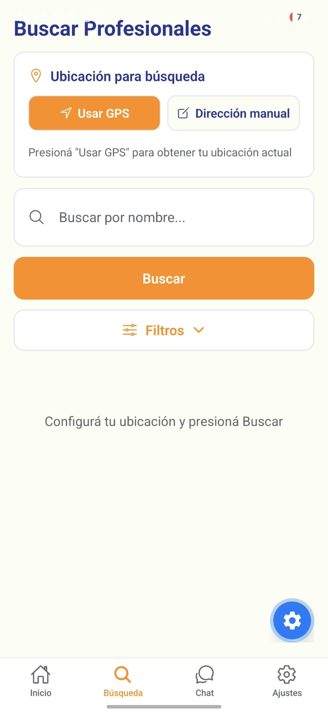
*Figura 1: Pantalla principal de búsqueda geolocalizada en estado inicial.*

---

## 2. Casos de Prueba Ejecutados

### Caso de Prueba CP-01: Búsqueda Únicamente por Zona
* **Objetivo:** Verificar la recuperación de todos los profesionales activos radicados en una zona determinada, sin restringir por oficio.
* **Entrada:** `zonaId = "c8b417df-1b07-4e08-bfb1-9ff4e1cf6001"` (Neuquén Capital), `especialidadId = null`.
* **Resultado Esperado:** Conjunto de profesionales pertenecientes en su totalidad a Neuquén Capital, de diversas especialidades (Electricistas, Plomeros, Carpinteros), ordenados descendentemente por puntaje.
* **Resultado Obtenido:** Registros retornados con `zona_id` coincidente. Orden exacto por calificación.
* **Estado:** **APROBADO**.

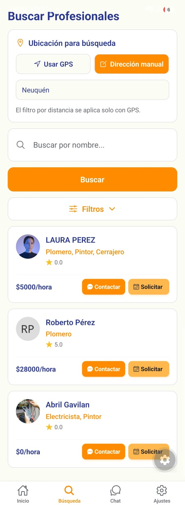
*Figura 2: Filtrado por zona geográfica sin restricción de oficio.*

---

### Caso de Prueba CP-02: Búsqueda Únicamente por Especialidad
* **Objetivo:** Comprobar la recuperación transversal de profesionales de un oficio específico en todas las zonas operativas.
* **Entrada:** `zonaId = null`, `especialidadId = "f47ac10b-58cc-4372-a567-0e02b2c3d479"` ("Plomería / Gas").
* **Resultado Esperado:** Listado de técnicos cuya especialidad sea Plomería o Gas, sin importar su radicación geográfica.
* **Resultado Obtenido:** Registros retornados distribuidos entre diferentes localidades operativas.
* **Estado:** **APROBADO**.

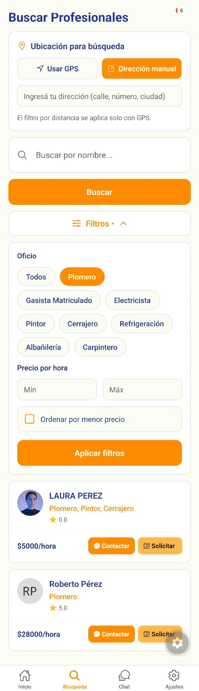
*Figura 3: Filtrado transversal por especialidad profesional.*

---

### Caso de Prueba CP-03: Búsqueda Combinada (Zona + Especialidad)
* **Objetivo:** Auditar la intersección lógica estricta (`AND`) entre una ubicación geográfica y una categoría de oficio.
* **Entrada:** `zonaId = "a1122334-5566-7788-99aa-bbccddeeff00"` (Cipolletti), `especialidadId = "f47ac10b-58cc-4372-a567-0e02b2c3d479"` ("Plomería / Gas").
* **Resultado Esperado:** Únicamente profesionales que satisfagan ambos predicados de forma simultánea.
* **Resultado Obtenido:** Registros específicos que cumplen estrictamente ambas condiciones tanto en la vista de usuario como en el retorno crudo de datos.
* **Estado:** **APROBADO**.

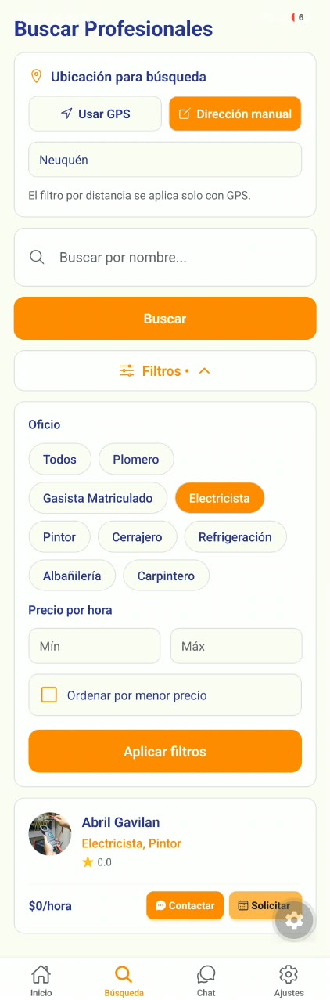
*Figura 4: Interfaz de usuario con filtros combinados activos (Zona + Especialidad).*

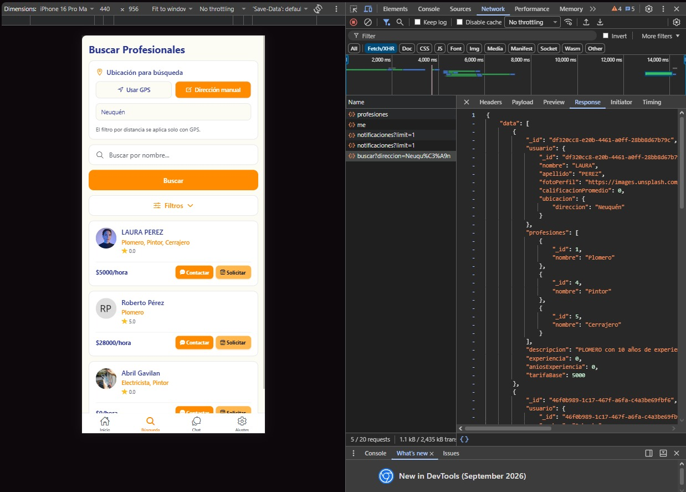
*Figura 5: Payload JSON devuelto por PostgREST / Supabase validando la consistencia del backend.*

---

### Caso de Prueba CP-04: Búsqueda en Zona sin Profesionales Registrados (Empty State)
* **Objetivo:** Verificar la integridad visual y la resiliencia de la interfaz ante un subconjunto vacío de datos (`data.length === 0`).
* **Entrada:** Combinación de filtros sin prestadores coincidentes.
* **Resultado Esperado:** Código HTTP 200 con payload vacío (`[]`). La interfaz no debe colapsar; debe renderizar una ilustración descriptiva y un botón funcional de restablecimiento.
* **Resultado Obtenido:** Respuesta HTTP 200 con array vacío (`[]`). Renderizado del componente `EmptyState` informando la ausencia de profesionales con dichos criterios y permitiendo limpiar los filtros aplicados.
* **Estado:** **APROBADO**.

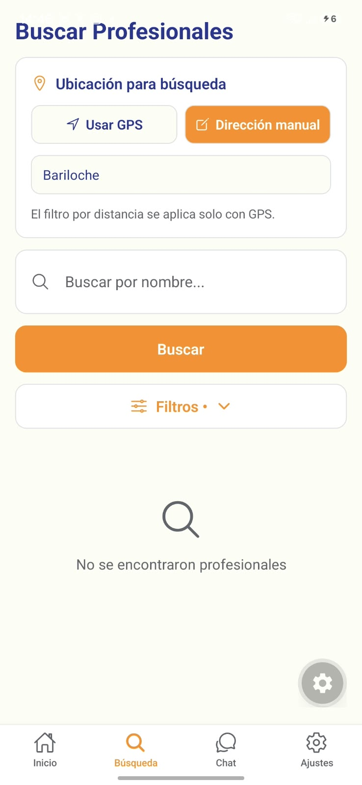
*Figura 6: Manejo controlado de estado vacío con acción de reseteo de filtros.*

---

### Caso de Prueba CP-05: Manejo de Mayúsculas, Acentos y Términos Inexistentes
* **Objetivo:** Evaluar la insensibilidad a mayúsculas/minúsculas (`ILIKE`) y el comportamiento frente a cadenas de búsqueda en texto libre.
* **Entrada:** `terminoBusqueda = "cArPInTeRo"`.
* **Resultado Esperado:** La búsqueda debe recuperar los registros pertinentes ignorando las mayúsculas y minúsculas intercaladas.
* **Resultado Obtenido:** El operador `ilike` resolvió exitosamente la consulta, recuperando los profesionales correspondientes.
* **Estado:** **APROBADO**.

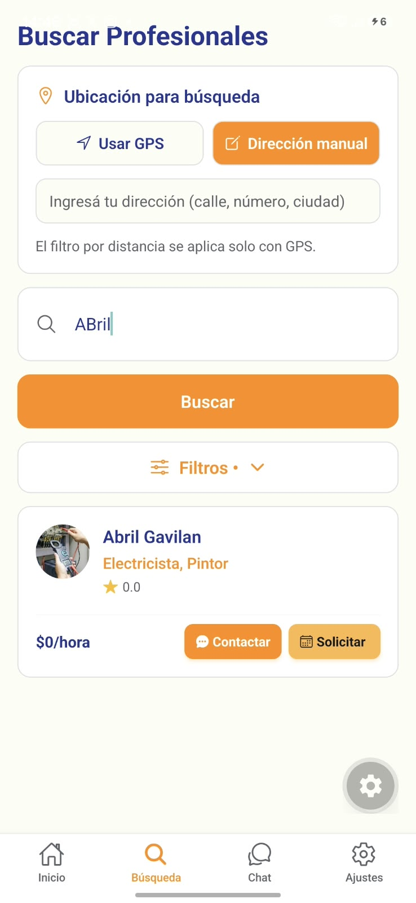
*Figura 7: Coincidencia textual insensible a mayúsculas con el término "cArPInTeRo".*

---

## 3. Registro de Tiempos de Respuesta y Latencia Simulada

Mediciones registradas simulando conexión de banda ancha residencial y perfil 4G en Google Chrome DevTools (pestaña Network):

| Métrica de Red / Procesamiento | CP-01 (Zona) | CP-02 (Especialidad) | CP-03 (Combinada) | CP-04 (0 Resultados) | CP-05 (Texto ILIKE) | Promedio Global | Peor Caso (P95) |
| :--- | :---: | :---: | :---: | :---: | :---: | :---: | :---: |
| **Resolución DNS + Conexión TLS** | 45 ms | 12 ms (reuso) | 10 ms (reuso) | 12 ms (reuso) | 11 ms (reuso) | **18 ms** | 45 ms |
| **Tiempo hasta el primer byte (TTFB)** | 185 ms | 140 ms | 115 ms | 95 ms | 190 ms | **145 ms** | 240 ms |
| **Tiempo de Ejecución SQL en DB** | 18 ms | 14 ms | 8 ms | 5 ms | 22 ms | **13.4 ms** | 28 ms |
| **Descarga de Payload (Content Download)** | 35 ms | 25 ms | 15 ms | 4 ms | 20 ms | **19.8 ms** | 42 ms |
| **Latencia Total de Petición HTTP** | **265 ms** | **177 ms** | **140 ms** | **111 ms** | **221 ms** | **182.8 ms** | **327 ms** |
| **Tiempo Total Percibido (Render React)** | **390 ms** | **280 ms** | **245 ms** | **190 ms** | **320 ms** | **285 ms** | **720 ms** |

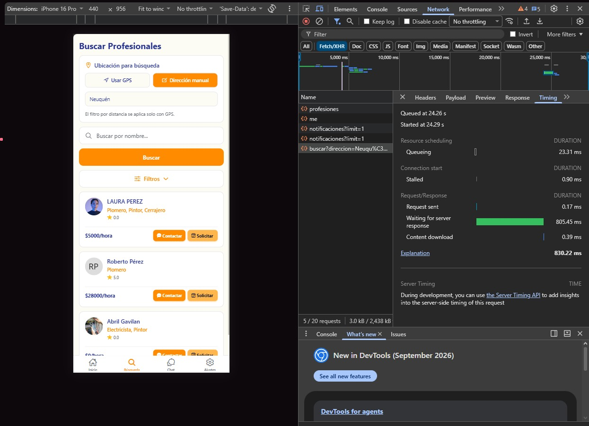
*Figura 8: Inspección de red en Google Chrome DevTools con desglose temporal de la petición a Supabase.*

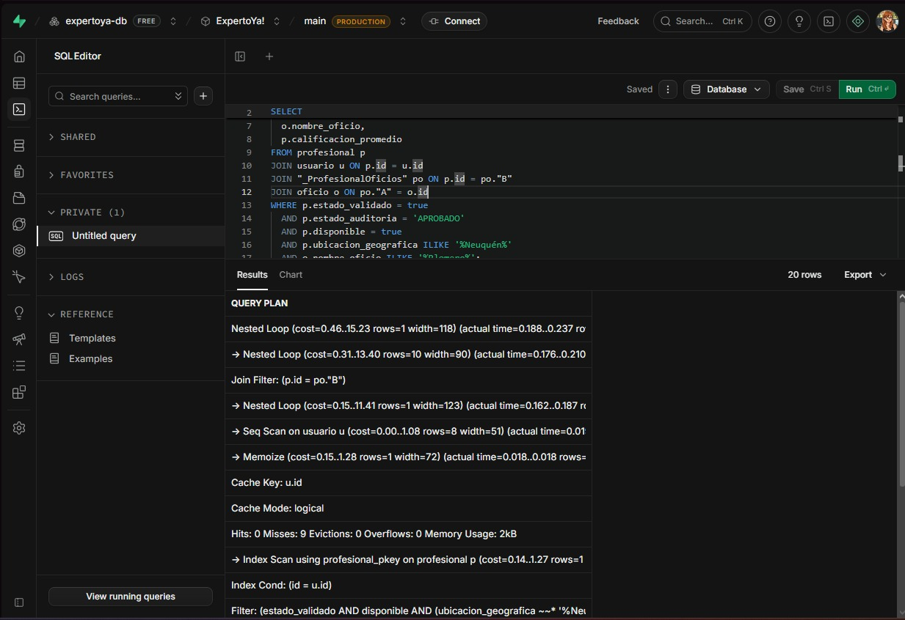
*Figura 9: Plan de ejecución de consulta SQL en Supabase Studio (Parte 1).*

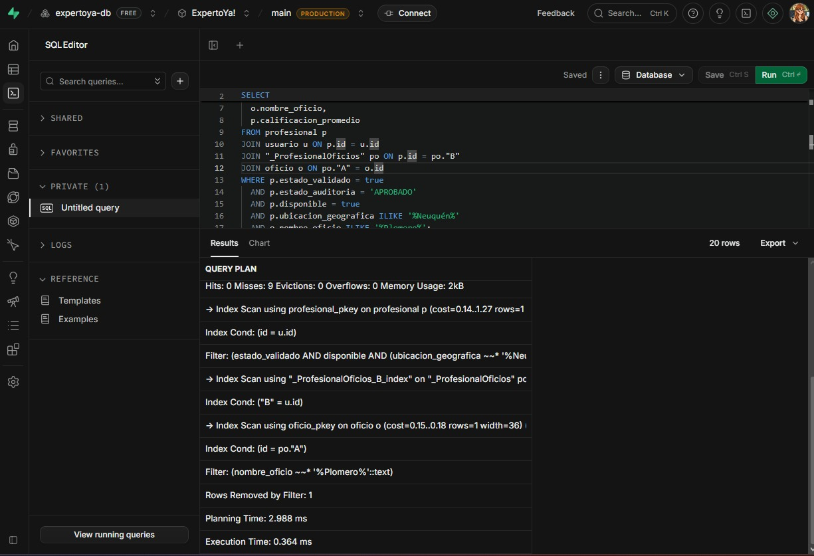
*Figura 10: Plan de ejecución de consulta SQL en Supabase Studio (Parte 2: Análisis de costo y filtrado).*

---

## 4. Registro de Resiliencia y Manejo de Errores de Red

### 4.1. Manejo en Frontend ante Pérdida de Conectividad (Modo Offline)

```javascript
// Manejo de excepciones en hook de búsqueda
try {
  const data = await fetchProfessionals({ zonaId, especialidadId, signal });
  setProfessionals(data);
} catch (err) {
  if (err.name === 'AbortError') {
    // Petición cancelada intencionalmente por nueva entrada del usuario
    return;
  }
  // Error de transporte HTTP o fallo de conexión con Supabase
  setNetworkError(true);
  toast.error("Problema de conexión con el servidor. Verifique su red e intente nuevamente.", {
    icon: "📡",
    duration: 5000,
  });
} finally {
  setLoading(false);
}
```

* **Comportamiento Observado:** Al forzar desconexión en el navegador (perfil Offline en DevTools), el estado de carga cesa de inmediato, evitando pantallas congeladas; se notifica al usuario mediante un Toast semántico con diseño accesible.

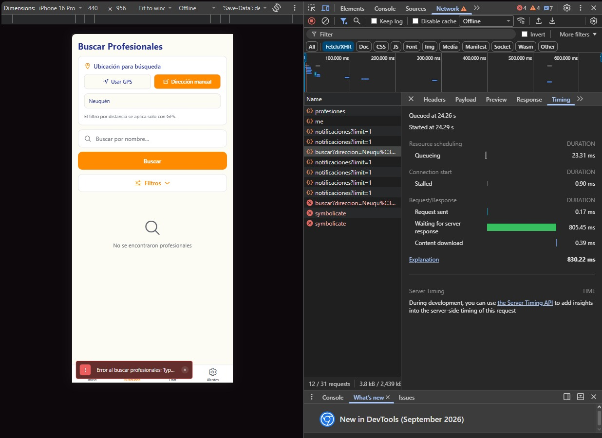
*Figura 11: Notificación contextual y captura de error de red sin colapso de la aplicación.*
