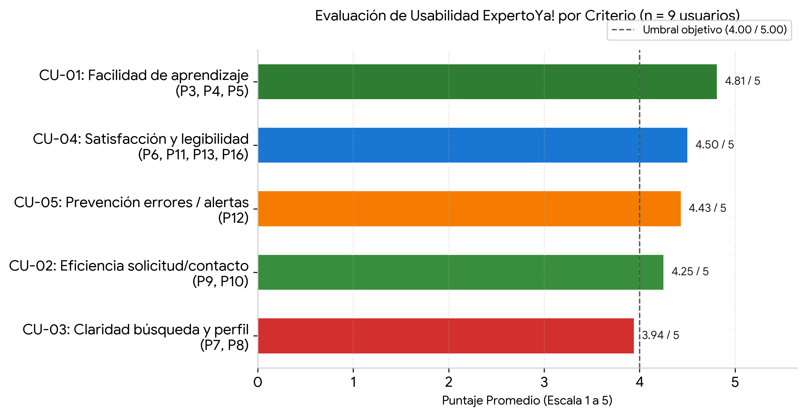
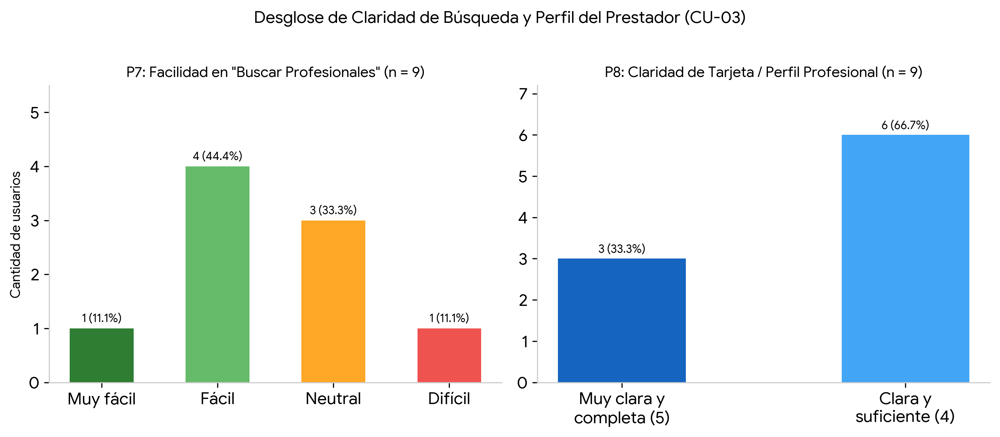
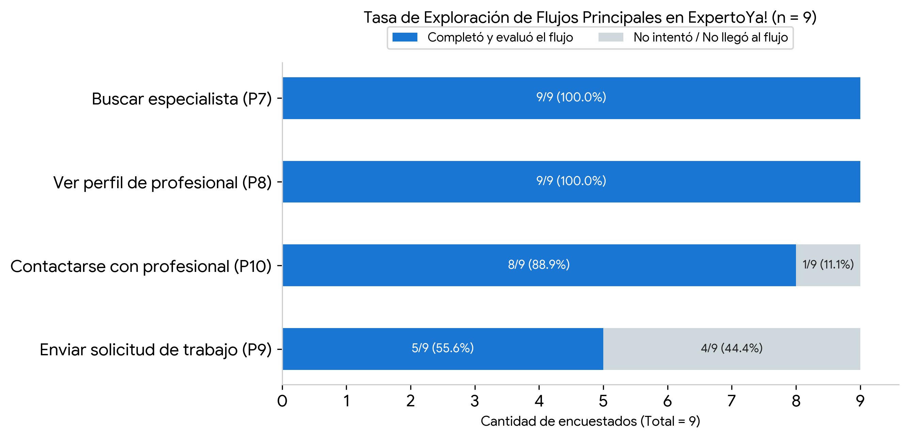
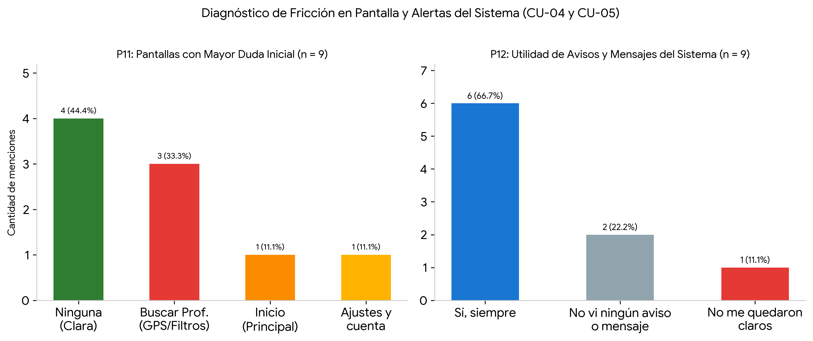

# TP4-11: Procesamiento de Resultados y Análisis de Problemas de Usabilidad

**Proyecto:** ExpertoYa!  
**Cátedra:** Frameworks e Interoperabilidad (TP4 – Actividad 2: Usabilidad)  
**Responsable:** Daniela Oñatibia  
**Muestra Total Recolectada:** $n = 9$ usuarios finales (rol: Cliente)  

---

## 1. Resumen Ejecutivo y Perfil de la Muestra

Con el objetivo de evaluar empíricamente el grado de cumplimiento de los **5 criterios de usabilidad críticos** definidos en `TP4-05`, se procesaron las **9 respuestas válidas** recolectadas mediante el instrumento publicado en Google Forms (`TP4-06` / `TP4-10`) sobre el despliegue móvil de **ExpertoYa!** (`https://expertoya-movil-pi.vercel.app/`).

### Caracterización Demográfica y Tecnológica ($n = 9$ encuestados)
- **Distribución etaria (P1):** El **44,4 %** (4 usuarios) pertenece al segmento de **18 a 25 años** y el **55,6 %** (5 usuarios) al segmento de **26 a 40 años**.
- **Familiaridad con aplicaciones de servicios/compras (P2):** El **88,9 %** (8 usuarios) utiliza este tipo de plataformas *"A veces"*, mientras que el **11,1 %** (1 usuario) declaró *"Casi nunca / Me cuesta usar estas apps"*, aportando visibilidad sobre usuarios con menor experiencia digital.
- **Condiciones externas durante la prueba (P15):** El **88,9 %** (8 usuarios) reportó *"Ninguno, no tuve problemas externos"*, mientras que el **11,1 %** (1 usuario) experimentó *"Mala señal de internet o datos móviles lentos"*.

En términos globales, **ExpertoYa! alcanzó un promedio general de 4,39 / 5,00** entre los cinco criterios evaluados, superando el umbral de aceptación de **4,00 / 5,00** en cuatro de las cinco dimensiones y ubicándose en **3,94 / 5,00** en la claridad de búsqueda geolocalizada y perfil (**CU-03**), donde se concentran las principales oportunidades de mejora.

---

## 2. Estadística Descriptiva por Criterio de Usabilidad (`TP4-05`)

> **Nota metodológica sobre el tamaño de muestra ($n$):**
 En las tablas siguientes, la variable **$n$** representa la **cantidad de usuarios que efectivamente evaluaron cada ítem o criterio** sobre la muestra total de 9 encuestados. Cuando un participante seleccionó una opción de no ejecución (*"No intenté enviar solicitud"*, *"No intenté contactarme"* o *"No vi ningún aviso o mensaje"*), dicha respuesta fue excluida del cálculo de promedios en escala 1–5 para no distorsionar la medición y se contabilizó por separado como **tasa de exploración de flujo**.

### Tabla 1: Resultados Consolidados por Criterio (Muestra total = 9 usuarios)

| ID | Criterio de Usabilidad (`TP4-05`) | Prioridad | Preguntas Asociadas | Usuarios Evaluadores ($n$) | Media ($\bar{x}$) | Mediana ($Me$) | Desvío Estándar ($s$) | Mín – Máx | Estado Frente a Umbral ($\ge 4,0$) |
| :--- | :--- | :---: | :--- | :---: | :---: | :---: | :---: | :---: | :--- |
| **CU-01** | Facilidad de aprendizaje (Intuitividad) | **P1** | P3, P4, P5 | 9 | **4,81** | **5,00** | **0,29** | 4,33 – 5,00 | Cumple ampliamente |
| **CU-04** | Satisfacción general, confianza y legibilidad | **P2** | P6, P11, P13, P16 | 9 | **4,50** | **4,50** | **0,31** | 4,25 – 5,00 | Cumple |
| **CU-05** | Prevención de errores y alertas semánticas | **P3** | P12, P14, P15 | 7 *(2 no vieron avisos)* | **4,43** | **5,00** | **1,51** | 1,00 – 5,00 | Cumple con alta dispersión |
| **CU-02** | Eficiencia de uso en solicitud y contacto | **P1** | P9, P10 | 8 *(1 no probó ambos)* | **4,25** | **4,25** | **0,65** | 3,00 – 5,00 | Cumple (con baja tasa de envío en P9) |
| **CU-03** | Claridad de búsqueda geolocalizada y perfil | **P2** | P7, P8 | 9 | **3,94** | **4,00** | **0,63** | 3,00 – 5,00 | **Levemente bajo umbral (< 4,00)** |

### Tabla 2: Desglose Estadístico por Pregunta Evaluada (Escala 1–5)

| Pregunta | Métrica Evaluada | Respuestas Válidas ($n$) | Media ($\bar{x}$) | Mediana ($Me$) | Desvío ($s$) | Mín | Máx | Observación Clave |
| :--- | :--- | :---: | :---: | :---: | :---: | :---: | :---: | :--- |
| **P3** | Rapidez para ubicar buscador al ingresar | 9 de 9 | **4,67** | 5,00 | 0,50 | 4 | 5 | 66,7 % lo encontró de inmediato; 33,3 % tardó unos segundos. |
| **P4** | Claridad de íconos de la plataforma | 9 de 9 | **4,89** | 5,00 | 0,33 | 4 | 5 | 88,9 % calificó con 5; 11,1 % con 4. |
| **P5** | Comodidad de barra de navegación inferior | 9 de 9 | **4,89** | 5,00 | 0,33 | 4 | 5 | 88,9 % calificó con 5; 11,1 % con 4. |
| **P6** | Claridad de descripciones en *Ajustes* | 9 de 9 | **4,78** | 5,00 | 0,67 | 3 | 5 | 88,9 % comprendió todo; 11,1 % tuvo dudas puntuales. |
| **P7** | Facilidad en *"Buscar Profesionales"* | 9 de 9 | **3,56** | 4,00 | 0,88 | 2 | 5 | **Ítem más bajo:** 33,3 % Neutral (3) y 11,1 % Difícil (2). |
| **P8** | Claridad de tarjeta/perfil del profesional | 9 de 9 | **4,33** | 4,00 | 0,50 | 4 | 5 | 100 % consideró la información clara o muy completa. |
| **P9** | Facilidad para enviar solicitud de trabajo | 5 de 9 | **4,00** | 4,00 | 0,71 | 3 | 5 | **4 usuarios (44,4 %) no intentaron enviar una solicitud.** |
| **P10** | Facilidad para contactarse con profesional | 8 de 9 | **4,25** | 4,00 | 0,71 | 3 | 5 | 8 usuarios (88,9 %) probaron el flujo; 1 (11,1 %) no lo intentó. |
| **P11** | Ausencia de dudas iniciales por pantalla | 9 de 9 | **3,44** | 3,00 | 1,51 | 2 | 5 | **3 usuarios (33,3 %) señalaron dudas en *Buscar Profesionales*.** |
| **P12** | Claridad de avisos y mensajes del sistema | 7 de 9 | **4,43** | 5,00 | 1,51 | 1 | 5 | **2 usuarios (22,2 %) no vieron avisos; 1 (11,1 %) no los entendió.** |
| **P13** | Comodidad de letra, botones y colores | 9 de 9 | **5,00** | 5,00 | 0,00 | 5 | 5 | Consenso unánime (100 %) en legibilidad visual móvil. |
| **P16** | Probabilidad de recomendar ExpertoYa! | 9 de 9 | **4,78** | 5,00 | 0,67 | 3 | 5 | 88,9 % asignó 5/5; 11,1 % asignó 3/5. |

---

## 3. Identificación del Top 3 de Problemas con Evidencia

Del cruce entre los indicadores cuantitativos más bajos y las respuestas abiertas (P14), emergen **tres focos principales de fricción**:

### Problema 1 (Severidad Alta): Fricción y falta de claridad en la pantalla *"Buscar Profesionales"* (GPS y Filtros)
- **Evidencia cuantitativa:** Es el ítem peor puntuado de todo el instrumento (**P7: $\bar{x} = 3,56$, $s = 0,88$, mínimo = 2**), posicionando al criterio **CU-03** por debajo del objetivo (**$\bar{x} = 3,94$**). Asimismo, en **P11**, el **33,3 % de los usuarios (3 de 9)** señaló explícitamente a *"Buscar Profesionales (GPS / Filtros)"* como la pantalla donde sintió mayor duda al usarla por primera vez.
- **Evidencia cualitativa (P14):** Los dos únicos reportes críticos recibidos en la pregunta abierta apuntan directamente a este módulo:
  - *"Me costó un poco cómo funcionaba el buscador."* (Encuestado #2, 18–25 años).
  - *"Búsqueda de profesionales y aplicación de filtros."* (Encuestado #7, 18–25 años).

### Problema 2 (Severidad Media-Alta): Baja tasa de completitud en el envío de solicitudes de trabajo (44,4 % de omisión)
- **Evidencia cuantitativa:** Mientras que los **9 encuestados (100 %)** buscaron especialistas (P7) y revisaron tarjetas de perfil (P8), y **8 de 9 (88,9 %)** iniciaron contacto (P10), **solo 5 de 9 usuarios (55,6 %)** llegaron a enviar una solicitud de trabajo (P9); los otros 4 usuarios (44,4 %) marcaron *"No intenté enviar solicitud"*, y quienes sí completaron el flujo promediaron **4,00 / 5** (con un reporte *Neutral* = 3).
- **Interpretación:** El flujo entre visualizar el perfil/contactar y formalizar una solicitud de trabajo carece de una jerarquía visual clara o de un llamado a la acción (*Call to Action*) evidente, provocando que casi la mitad de los exploradores no active dicha función.

### Problema 3 (Severidad Media): Baja visibilidad y ambigüedad en los mensajes y alertas semánticas del sistema
- **Evidencia cuantitativa:** En **P12**, el criterio **CU-05** presentó una alta dispersión (**$s = 1,51$**): **2 usuarios (22,2 %)** declararon *"No vi ningún aviso o mensaje durante la prueba"* y **1 usuario (11,1 %)** respondió *"No me quedaron claros"*. En conjunto, **3 de los 9 usuarios (33,3 %) no recibieron retroalimentación efectiva** tras ejecutar acciones o filtros.
- **Impacto:** Coincide con la fricción reportada en los filtros de búsqueda: cuando un filtro no arroja resultados o requiere confirmar parámetros, la ausencia de un banner o estado vacío explicativo deja al usuario sin guía sobre cómo continuar.

---

## 4. Clasificación de Hallazgos: Subsanables vs. Insubsanables

En respuesta a la consigna sobre si existen problemas de usabilidad que no puedan resolverse desde el desarrollo de la aplicación, se discriminaron los hallazgos detectados en dos categorías:

### A. Hallazgos Subsanables por Código (Responsabilidad del Equipo de Desarrollo)

| ID Hallazgo | Descripción del Problema | Criterio Afectado | Justificación de Subsanabilidad |
| :--- | :--- | :---: | :--- |
| **HS-01** | **Fricción en controles de búsqueda y aplicación de filtros** en la vista *Buscar Profesionales* (etiquetas poco autoexplicativas y falta de feedback inmediato al filtrar por zona/oficio). | **CU-03** / **CU-01** | Depende íntegramente de la interfaz de usuario (`BuscarScreen`), placeholders, etiquetas de filtros y estado de resultados en React Native / Expo. |
| **HS-02** | **Baja descubribilidad del flujo de envío de solicitud de trabajo** (4 de 9 usuarios no intentaron utilizarlo frente a 8 de 9 que usaron el contacto). | **CU-02** | Se resuelve mediante jerarquía visual en la tarjeta/detalle del profesional, diferenciando claramente los botones *"Solicitar presupuesto/trabajo"* y *"Enviar mensaje"*. |
| **HS-03** | **Invisibilidad o poca claridad de alertas semánticas y estados vacíos** tras aplicar filtros o ejecutar acciones (3 de 9 sin feedback claro). | **CU-05** | Se corrige incorporando componentes de alerta semántica (*éxito, advertencia, sin resultados*) con mensajes accionables (ej. botón *"Limpiar filtros"*). |
| **HS-04** | **Ambigüedad terminológica y dudas iniciales en *Ajustes*** reportada en P6 (1 usuario) y P11 (1 usuario). | **CU-04** | Subsanable mediante microcopy descriptivo más claro en los subtítulos de *Métodos de Pago*, *Notificaciones* y *Seguridad*. |

### B. Hallazgos No Subsanables / Insubsanables (Factores Externos al Sistema)

| ID Hallazgo | Factor Externo Evaluado | Evidencia en Muestra (9 encuestados) | Justificación de No Subsanabilidad |
| :--- | :--- | :---: | :--- |
| **HI-01** | **Conectividad móvil inestable y latencia de red** en consultas al backend desplegado en la nube. | **11,1 % (1 de 9)** reportó *"Mala señal de internet o datos móviles lentos"* en P15 (coincidiendo con valoraciones neutrales en P7, P9 y P10). | La velocidad y estabilidad de los datos móviles (4G/Wi-Fi) del cliente son ajenas a la aplicación. En escenarios de urgencia domiciliaria condiciona los tiempos de carga de listas y solicitudes. |
| **HI-02** | **Precisión del sensor GPS y permisos de geolocalización del dispositivo del usuario** al filtrar profesionales cercanos en Neuquén, Cipolletti y Plottier. | Relevado en P11 (3 de 9 con dudas en GPS/Filtros) | La exactitud de coordenadas depende del hardware GPS del smartphone, el navegador web móvil y los permisos del sistema operativo del usuario; el software solo puede ofrecer selección manual de ciudad como respaldo. |
| **HI-03** | **Limitaciones físicas del hardware del usuario** (tamaño de pantalla reducido, iluminación ambiental al capturar fotos de fallas). | 0 % afectado en P15; P13 = 5,00/5 | El tamaño físico del dispositivo y las condiciones lumínicas del entorno están fuera del control del código fuente, mitigables únicamente mediante diseño responsivo (validado con puntaje perfecto de 5,00/5 en P13). |

---

## 5. Plan de Acción Propuesto para Hallazgos Subsanables

Para resolver los cuatro hallazgos subsanables antes del cierre del ciclo de desarrollo, se proponen las siguientes intervenciones técnicas con su estimación de esfuerzo:

| Hallazgo | Acción Concreta Propuesta | Componente / Archivo Afectado (`expertoya-movil`) | Esfuerzo Estimado | Prioridad |
| :--- | :--- | :--- | :---: | :---: |
| **HS-01** | Rediseñar la cabecera de filtros en *Buscar Profesionales*: agregar chips visuales de categorías de oficio visibles sin desplegar menús ocultos, etiqueta explícita en el selector de ciudad (*Neuquén, Cipolletti, Plottier*) y contador dinámico de resultados encontrados (*"Mostrando X profesionales"*). | `src/screens/BuscarProfesionalesScreen.tsx` / componentes de filtro | **4 horas** (3 SP) | **Alta (P1)** |
| **HS-02** | Incorporar un botón primario destacado **"Solicitar Trabajo"** tanto en la vista expandida del perfil del profesional como en la barra inferior de la tarjeta, acompañado de un breve texto guía en la pantalla de inicio (*"Buscá un oficio, revisá su perfil y enviá tu solicitud"*). | `src/components/ProfesionalCard.tsx` y `src/screens/PerfilProfesionalScreen.tsx` | **3 horas** (2 SP) | **Alta (P1)** |
| **HS-03** | Implementar un componente unificado de **Estado Vacío y Alerta Semántica** (`EmptyStateAlert`): cuando una búsqueda con filtros no devuelva coincidencias, mostrar un mensaje claro (*"No encontramos profesionales con esos filtros"*) con un botón de un toque para **"Restablecer filtros"**, además de notificaciones *toast* visibles al enviar una solicitud. | `src/components/ui/AlertBanner.tsx` y `src/screens/BuscarProfesionalesScreen.tsx` | **3 horas** (2 SP) | **Media (P2)** |
| **HS-04** | Revisar y simplificar las descripciones de los ítems en la pantalla *Ajustes* (especialmente *Métodos de Pago* y *Seguridad*) reemplazando términos técnicos por lenguaje cotidiano orientado al cliente. | `src/screens/AjustesScreen.tsx` | **1 hora** (1 SP) | **Baja (P3)** |

---

## 6. Conclusiones

1. **Fortalezas validadas:** ExpertoYa! demuestra una curva de aprendizaje sobresaliente (**CU-01 = 4,81 / 5**) y una legibilidad visual móvil óptima (**P13 = 5,00 / 5**), lo que se traduce en una alta disposición a recomendar la plataforma (**8 de 9 usuarios / 88,9 %** otorgaron 5/5 en P16).
2. **Foco prioritario de mejora:** El único criterio que quedó levemente debajo del umbral objetivo fue **CU-03 (3,94 / 5)** debido a la fricción en los filtros de *Buscar Profesionales* (P7 = 3,56). Las mejoras de mayor impacto son subsanables por código (**HS-01, HS-02 y HS-03**), estimando un esfuerzo total de **11 horas de desarrollo** para elevar todos los indicadores por encima de 4,50 / 5.