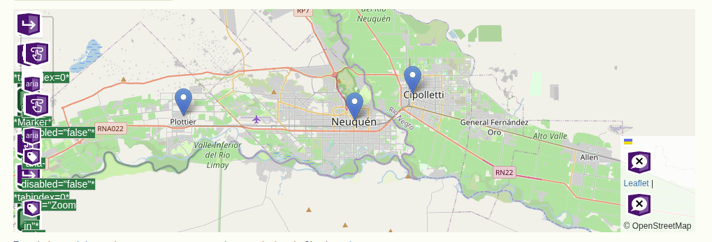
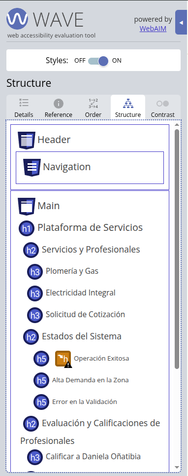
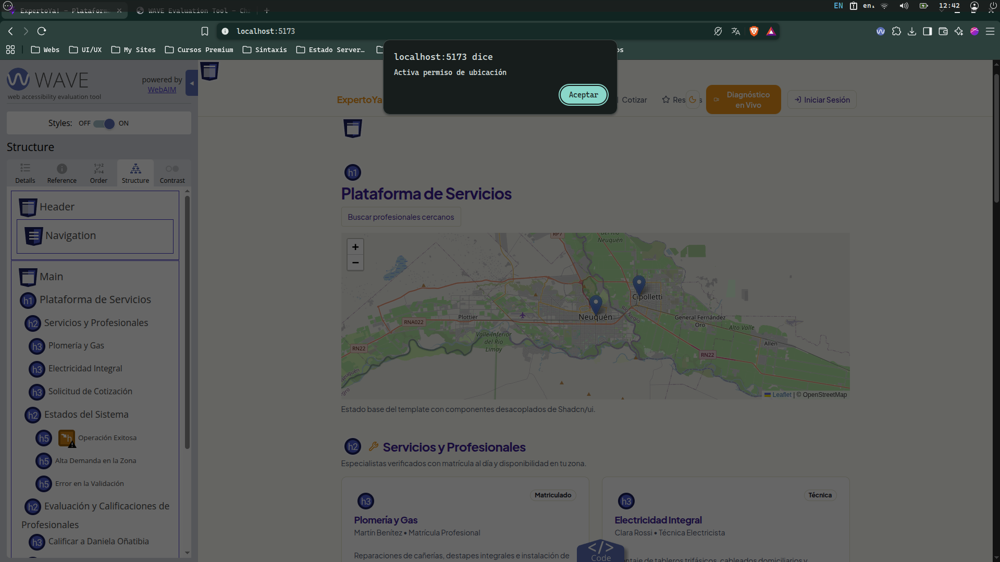
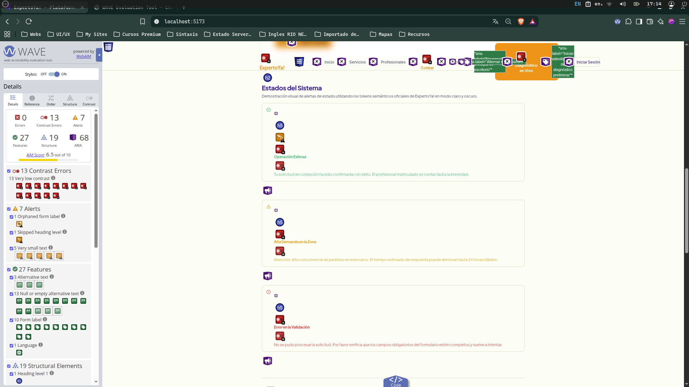
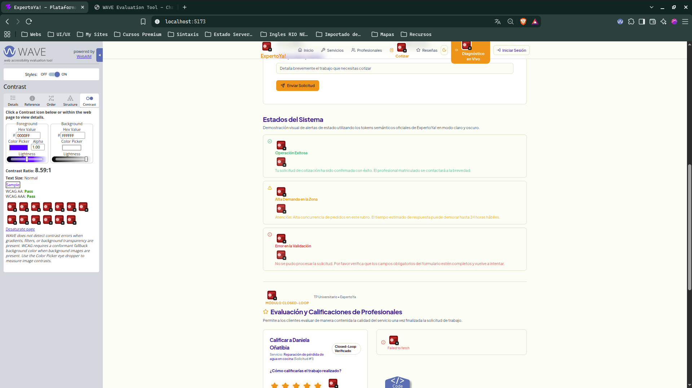
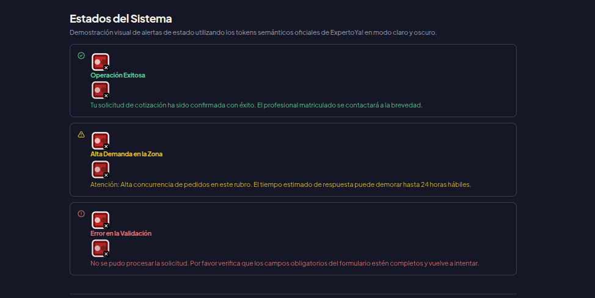
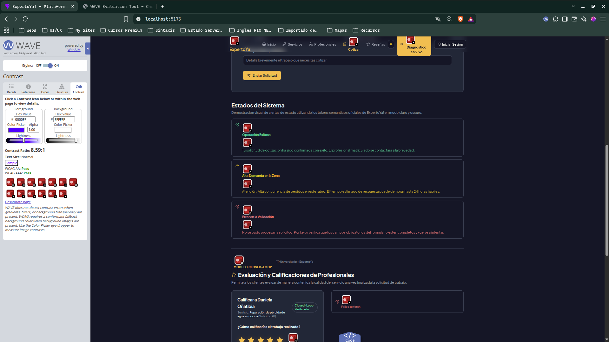

# TP4 · Actividad 3 · Auditoría de accesibilidad con WAVE

## 1. Objetivo y alcance

Identificar las secciones de ExpertoYa que no son accesibles y explicar por qué, usando WAVE como herramienta de evaluación. La auditoría se ejecutó sobre la aplicación local (`http://localhost:5173`) con la extensión oficial de WebAIM, en modo claro y oscuro.

La aplicación es una SPA de una sola página con secciones ancladas, no rutas independientes. Por eso las "pantallas" se identifican por sección y URL con ancla.

## 2. Metodología

- WAVE Evaluation Tool (WebAIM) sobre Chrome, con la página cargada y el backend detenido.
- Registro de contadores, pestaña Details, pestaña Structure y pestaña Contrast.
- Verificación manual del contraste con los tokens de `src/index.css` y el selector de color de WAVE.
- Clasificación de severidad: Crítica (impide la tarea), Alta (la dificulta seriamente), Media (fricción evitable), Baja (molestia menor).

## 3. Resumen de contadores

| Pantalla | Errores | Contraste | Alertas | Features | Structure | ARIA | AIM |
|---|---|---|---|---|---|---|---|
| Inicio (claro) | 0 | 13 | 7 | 32 | 19 | 68 | 6.5 |
| Mapa / búsqueda | 0 | 13 | 7 | 27 | 19 | 68 | 6.5 |
| Servicios | 0 | 13 | 7 | 27 | 19 | 68 | 6.5 |
| Perfil (ficha) | 0 | 13 | 7 | 27 | 19 | 68 | 6.5 |
| Cotización | 0 | 13 | 7 | 27 | 19 | 68 | 6.5 |
| Estados (claro) | 0 | 13 | 7 | 27 | 19 | 68 | 6.5 |
| Reseñas | 0 | 13 | 7 | 27 | 19 | 68 | 6.5 |
| Registro | 0 | 13 | 7 | 27 | 19 | 68 | 6.5 |
| Inicio / Estados (oscuro) | 0 | 0 | 7 | 26 | 19 | 68 | 9.8 |

**Lectura clave:** WAVE reporta 0 "Errors" en todas las pantallas. Eso no significa que sean accesibles: los 13 errores de contraste y los 7 avisos son transversales, y los problemas estructurales (mapa sin alternativa, encabezados saltados, mensajes sin rol) no aparecen como "Errors" porque WAVE no los puede inferir del HTML estático.

## 4. Tabla de hallazgos

| Pantalla | URL | Errores | Alertas | Contraste | Problema | Por qué afecta | Solución propuesta |
|---|---|---|---|---|---|---|---|
| Inicio | `/#inicio` | 0 | 7 | 13 | Logo, ítem activo y varios íconos usan naranja `#FF8C00` sobre crema `#FDFCF4` (2.27:1). | Baja visión: no se lee el nombre del sitio ni el ítem activo de la navegación; los íconos no alcanzan 3:1. | Usar un naranja más oscuro para texto (p. ej. `#B45309`, 4.5:1) y reservar `#FF8C00` para fondos. |
| Inicio | `/#inicio` | 0 | 7 | 13 | `h1` → `h2` → `h3` correcto en Servicios, pero "Solicitud de Cotización" es `h3` sin `h2` que la contenga. | Lectores de pantalla arman un índice con secciones de distinto nivel; saltar o mezclar niveles desorienta. | Dar `h2` a Cotización, Reseñas, Módulo de Usuarios y Mapa; dejar `h3` solo para tarjetas. |
| Mapa / búsqueda | `/#mapa` | 0 | 7 | 13 | El mapa no aparece en el árbol de Structure: no tiene encabezado propio, lista de resultados ni texto alternativo. | Un usuario de lector de pantalla recorre un `div` sin contenido: no sabe que hay 3 profesionales ni puede acceder a sus nombres. | `<section aria-labelledby>` + `<h2>` "Profesionales en tu zona"; vista de lista obligatoria. |
| Mapa / búsqueda | `/#mapa` | 0 | 7 | 13 | Marcadores Leaflet sin `alt` útil; los nombres solo existen en popups que requieren clic. | La información principal queda inaccesible para lectores de pantalla y teclado. | `alt`/`title` por marcador y vista de lista equivalente. |
| Mapa / búsqueda | `/#mapa` | 0 | 7 | 13 | El botón "Buscar profesionales cercanos" no anuncia resultados (sin `aria-live`, `aria-controls` ni estado). | Al filtrar a 2 profesionales el cambio es silencioso; el usuario no sabe si la búsqueda funcionó. | Región `aria-live="polite"` con "Se encontraron N profesionales". |
| Mapa / búsqueda | `/#mapa` | 0 | 7 | 13 | Al denegar la ubicación se ejecuta `alert("Activa permiso de ubicación")`. | Bloquea toda la página, no ofrece alternativa ni reintento y no está asociado al botón. | Mensaje `role="alert"` junto al botón + opción de elegir zona manualmente. |
| Mapa / búsqueda | `/#mapa` | 0 | 7 | 13 | No existe vista de lista. | Usuarios de lector de pantalla o solo teclado no tienen forma equivalente de obtener los resultados. | Alternancia Mapa/Lista con `aria-pressed` y foco gestionado (TP4-14). |
| Servicios | `/#servicios` | 0 | 7 | 13 | Las tarjetas son `div` sueltos, no `<ul>/<li>` ni `role="list"`. | El lector de pantalla no anuncia "3 profesionales" ni permite saltar de tarjeta en tarjeta. | Lista semántica con un `h3` por profesional. |
| Servicios | `/#servicios` | 0 | 7 | 13 | El botón "Ver Perfil" no tiene `onClick` ni `href`. | Control engañoso: se enfoca, se activa y no ocurre nada; no existe pantalla de perfil. | Implementar la ruta/modal de perfil o convertir el botón en enlace real. |
| Perfil | Módulo de Usuarios | 0 | 7 | 13 | "Ficha de Perfil Público" y "Martín Benítez" son ambos `h3`. | El nombre del profesional queda al mismo nivel que el título de la tarjeta, no anidado. | Usar `h2` para la ficha y `h3` para el nombre, o `h4` si se mantiene la tarjeta. |
| Perfil | Módulo de Usuarios | 0 | 7 | 13 | El botón `ID #1` seleccionado se distingue solo por color; sin `aria-pressed`. | Un lector de pantalla no sabe qué perfil está visible. | `aria-pressed` o `aria-current` + texto "Perfil seleccionado". |
| Cotización | `/#cotizacion` | 0 | 7 | 13 | "Descripción del problema" es un `<input>` de una línea y no un `<textarea>`. | Dificulta revisar y corregir descripciones largas; peor experiencia en móvil. | Cambiar a `<textarea rows="4">` con contador. |
| Cotización | `/#cotizacion` | 0 | 7 | 13 | Campos sin `required` ni `aria-required`; la validación es manual al enviar. | El usuario descubre que faltan datos recién al enviar; mayor carga cognitiva. | `required`, `aria-required` y ayudas visibles. |
| Cotización | `/#cotizacion` | 0 | 7 | 13 | El error aparece debajo del botón, sin mover el foco ni marcar los campos. | Usuarios de lector de pantalla o teclado no encuentran qué corregir; el mensaje es genérico. | `aria-invalid` + `aria-describedby`, foco al primer campo con error y mensaje específico. |
| Cotización | `/#cotizacion` | 0 | 7 | 13 | El texto de error rojo `#EF4444` sobre `bg-destructive/10` da 3.4:1. | No alcanza 4.5:1 para texto normal; con baja visión el mensaje se pierde. | Texto oscuro sobre fondo tintado o fondo sólido con contraste ≥ 4.5:1. |
| Estados | `/#estados` | 0 | 7 | 13 | Los títulos y descripciones de las tres alertas no cumplen contraste: éxito 2.2:1, advertencia 1.9:1, error 3.4:1. | Los mensajes de estado son críticos y quedan ilegibles para baja visión. | Tokens de texto oscuro sobre fondo tintado; verificar con color picker por la transparencia. |
| Estados | `/#estados` | 0 | 7 | 13 | Los tres mensajes estáticos tienen `role="alert"`. | Al cargar la página se anuncian tres alertas assertive de golpe, fuera de contexto. | `role="status"` para el demo estático; `role="alert"` solo para errores dinámicos. |
| Estados | `/#estados` | 0 | 7 | 13 | `h2 Estados del Sistema` → `h5` en cada `AlertTitle`. | Salto de tres niveles repetido; el índice del lector queda inconsistente. | `AlertTitle` como `h3` (o `h2` si la alerta es sección). |
| Reseñas | `/#resenas` | 0 | 7 | 13 | El `<Label>` "¿Cómo calificarías el trabajo realizado?" no está asociado a ningún control. | WAVE lo marca como huérfano; el lector anuncia cinco botones sin pregunta. | `fieldset/legend` o `role="radiogroup"` con `aria-labelledby`. |
| Reseñas | `/#resenas` | 0 | 7 | 13 | Las estrellas son 5 botones sin `aria-pressed` ni navegación con flechas. | No se anuncia la calificación elegida; cinco tab stops para una sola decisión. | Radiogroup con `aria-checked` y flechas; anunciar "N de 5" en `aria-live`. |
| Reseñas | `/#resenas` | 0 | 7 | 13 | "5 de 5 estrellas" en naranja sobre blanco; badge de 11px. | Contraste insuficiente y texto muy pequeño para baja visión. | `text-foreground` o naranja oscuro; tamaño mínimo 12–14px. |
| Reseñas | `/#resenas` | 0 | 7 | 13 | El error "Failed to fetch" es un `div` sin `role="alert"`; el estado de carga tampoco se anuncia. | Si falla la red, el usuario de lector no se entera; mensaje en inglés. | `role="alert"` en error y `role="status"` en carga, en español. |
| Registro | Módulo de Usuarios | 0 | 7 | 13 | Al elegir "Cliente" desaparece "Oficio o Especialidad" sin aviso. | El lector no sabe que el formulario cambió; puede quedar desorientado. | `aria-live` con "Campo de oficio oculto para clientes" y `aria-expanded` si se usa acordeón. |
| Registro | Módulo de Usuarios | 0 | 7 | 13 | Los mensajes de éxito/error son `
` sin `role="alert"`. | No se anuncian al completar el registro. | `role="alert"` / `role="status"` según el caso. |
| Registro | Módulo de Usuarios | 0 | 7 | 13 | No se indica qué campos son opcionales (Zona, Oficio). | El usuario asume que todo es obligatorio o descubre lo contrario tarde. | Texto "(opcional)" en el label. |
| Modo oscuro | `/#inicio` y `/#estados` | 0 | 7 | 0 | Sin errores de contraste (AIM 9.8), pero el mapa conserva tiles claros. | Cambio brusco de luminancia en entorno oscuro; deslumbra y rompe la adaptación visual. | Filtro/tema oscuro para tiles o una capa oscura sobre el mapa. |
| Login | Header | — | — | — | No implementado: el botón no abre modal ni ruta. | No se puede evaluar la pantalla; el flujo de inicio de sesión no existe. | Implementar y auditar en la próxima iteración. |
| Perfil de profesional | — | — | — | — | No existe como pantalla independiente: "Ver Perfil" no navega. | No se puede evaluar; el flujo queda incompleto para el usuario. | Implementar la vista y auditarla en TP4-14. |

## 5. Foco especial: mapa interactivo

### Evidencia

### Problemas

1. **El mapa no está en el árbol de estructura.** En la pestaña Structure solo aparecen `Header > Navigation`, `Main`, `h1`, `h2 Servicios…`; el mapa no tiene encabezado, región ni lista.
2. **Los marcadores no tienen alternativa textual.** Los nombres de los profesionales solo se leen al abrir un popup con clic.
3. **No hay vista de lista.** Es el problema central que señala la guía del TP.
4. **`alert()` bloquea la página** al denegar la ubicación y no ofrece camino alternativo.
5. **Los resultados no se anuncian** al buscar.

### Solución propuesta

- Envolver el mapa en `<section aria-labelledby="mapa-titulo">` con `<h2 id="mapa-titulo">Profesionales en tu zona</h2>`.
- Implementar alternancia **Mapa / Lista** (`aria-pressed`, foco gestionado). La lista debe exponer nombre, oficio, distancia y acción "Ver perfil" en HTML semántico.
- `aria-label` en el contenedor del mapa y `alt`/`title` en cada marcador: "Martín Benítez, Plomería y Gas, Neuquén Capital".
- Región `aria-live="polite"` para anunciar "Se encontraron 2 profesionales cerca de tu ubicación".
- Reemplazar `alert()` por un mensaje `role="alert"` junto al botón, con opción de buscar por zona manualmente.

## 6. Foco especial: alertas semánticas

### Evidencia

### Problemas

1. Las tres alertas estáticas usan `role="alert"` (assertive): se anuncian las tres al cargar la página.
2. Los textos de éxito, advertencia y error no alcanzan 4.5:1 en modo claro (2.2:1, 1.9:1 y 3.4:1). En oscuro sí cumplen (0 errores de contraste).
3. Cada `AlertTitle` es un `h5`, lo que produce un salto `h2 → h5` tres veces.
4. Las alertas usan fondos con transparencia (`/10`, `/15`), lo que impide que WAVE mida bien el contraste; hay que confirmar con el color picker.

### Solución propuesta

- Demo estático con `role="status"`; reservar `role="alert"` para el error dinámico del formulario.
- `AlertTitle` como `h3`.
- Texto oscuro sobre fondo tintado o fondo sólido con contraste ≥ 4.5:1; mantener ícono + texto (no depender solo del color).

## 7. Priorización por severidad

| Severidad | Hallazgo | Pantalla |
|---|---|---|
| Crítica | Mapa sin alternativa textual ni vista de lista | Mapa |
| Crítica | `alert()` bloquea la página y no ofrece alternativa | Mapa |
| Crítica | "Ver Perfil" no hace nada; no existe pantalla de perfil | Servicios |
| Alta | 13 errores de contraste en modo claro (logo, navegación, alertas) | Todas |
| Alta | Contraste de las tres alertas (2.2:1 / 1.9:1 / 3.4:1) | Estados |
| Alta | `role="alert"` en contenido estático | Estados |
| Alta | Label huérfano y estrellas sin grupo semántico | Reseñas |
| Alta | Saltos de encabezado `h2 → h5` y secciones en `h3` | Todas |
| Media | Mensajes de éxito/error sin rol en registro y reseñas | Registro, Reseñas |
| Media | Validación y errores de cotización sin asociación | Cotización |
| Media | Campo condicional de registro sin anuncio | Registro |
| Media | Tiles claros en modo oscuro | Mapa |
| Baja | Textos de 10–11px (badges, chips) | Inicio, Reseñas |
| Baja | Botones de ID sin `aria-pressed` | Perfil |

## 8. Capturas

Todas las capturas están en `docs/TP4/accesibilidad/img/wave/`:

| Archivo | Pantalla |
|---|---|
| `01-home-claro-a-overlay.png` | Inicio, panel de contadores |
| `01-home-claro-b-detalle.png` | Inicio, página completa con WAVE |
| `02-mapa-a-overlay.png` | Mapa con marcadores |
| `02-mapa-b-structure.png` | Structure sin el mapa |
| `02-mapa-c-geolocalizacion.png` | `alert()` de ubicación |
| `03-servicios-a-overlay.png` | Servicios |
| `03-servicios-b-detalle.png` | Tarjetas en detalle |
| `03-perfil-a-overlay.png` | Registro y ficha de perfil |
| `03-perfil-b-detalle.png` | Ficha de perfil |
| `04-cotizacion-a-overlay.png` | Cotización |
| `04-cotizacion-b-detalle.png` | Formulario en detalle |
| `04-cotizacion-c-error.png` | Error de validación |
| `05-estados-a-overlay.png` | Estados en claro |
| `05-estados-b-contrast.png` | Pestaña Contrast en claro |
| `05-estados-c-oscuro.png` | Estados en oscuro |
| `05-estados-d-oscuro-contrast.png` | Contrast en oscuro |
| `06-resenas-a-overlay.png` | Reseñas |
| `06-resenas-b-detalle.png` | Reseñas en detalle |
| `07-registro-a-overlay.png` | Registro |
| `07-registro-b-detalle.png` | Registro en detalle |
| `08-oscuro-a-home.png` | Inicio en oscuro (AIM 9.8) |
| `08-oscuro-b-estados.png` | Estados en oscuro |

## 9. Limitaciones

- El backend estaba detenido durante la auditoría: la lista de reseñas y los envíos de registro/cotización muestran errores de red. Se auditó la interfaz, no la respuesta real del servidor.
- WAVE no recalcula automáticamente al cambiar de tema; las capturas oscuras se tomaron re-ejecutando la extensión.
- Las alertas usan fondos con transparencia, por lo que WAVE advierte que el contraste puede no medirse con exactitud. Los ratios se verificaron con el color picker y los tokens de `src/index.css`.
- En las primeras capturas había una extensión adicional del navegador que superpone etiquetas de atributos ARIA (visible como recuadros verdes sobre el mapa). No pertenece a WAVE ni a la aplicación; no afecta los contadores, pero conviene repetir esas capturas con solo WAVE activo.
- Login y perfil de profesional como pantallas independientes no existen en el código actual: se documentan como N/A y se proponen para TP4-14.
