# TP4 · Actividad 3 · Auditoría con Lighthouse y prueba de diseño adaptable

## 1. Objetivo y alcance

Evaluar el rendimiento, la accesibilidad y la adaptabilidad de ExpertoYa con Lighthouse, y complementar el análisis con pruebas manuales de ancho, zoom, orientación y navegación por teclado.

La aplicación es una SPA de una sola página: Lighthouse audita el documento completo, no cada ancla. Por eso se realizaron cuatro corridas representativas (claro/oscuro × mobile/desktop) y las pruebas por sección se hicieron de forma manual.

## 2. Metodología

- Build de producción (`npm run build`) servido con `npm run preview` en `http://localhost:4173`.
- Lighthouse de Brave DevTools, en ventana de incógnito y sin extensiones.
- Categorías: Performance, Accessibility, Best Practices y SEO.
- Device: Mobile y Desktop; modo claro y oscuro.
- Pruebas manuales: 320, 768 y 1440 px; zoom 200 %; orientación horizontal 667×375; recorrido con Tab.
- Backend detenido durante la auditoría.

## 3. Puntajes de Lighthouse

| Corrida | Performance | Accessibility | Best Practices | SEO |
|---|---|---|---|---|
| Home claro · Mobile | 72 | 95 | 92 | 83 |
| Home claro · Desktop | 97 | 95 | 96 | 83 |
| Home oscuro · Mobile | 60 | 98 | 92 | 83 |
| Home oscuro · Desktop | 98 | 98 | 96 | 83 |

### Métricas

| Métrica | Claro mobile | Claro desktop | Oscuro mobile | Oscuro desktop |
|---|---|---|---|---|
| FCP | 2.8 s | 1.0 s | 3.0 s | 0.9 s |
| LCP | 4.0 s | 1.0 s | 4.2 s | 1.0 s |
| TBT | 410 ms | 0 ms | 880 ms | 0 ms |
| CLS | 0 | 0.015 | 0.006 | 0.015 |
| Speed Index | 2.8 s | 1.0 s | 3.0 s | 0.9 s |

**Lectura:** el rendimiento desktop es muy bueno (97–98) y el CLS es casi nulo. El rendimiento mobile es el punto débil (60–72), con LCP de 4 s y TBT alto. La diferencia entre las dos corridas mobile (72 vs 60) es variabilidad de red/CPU y de la carga de tiles de OpenStreetMap, no del tema: el HTML y la accesibilidad son los mismos.

### Evidencia

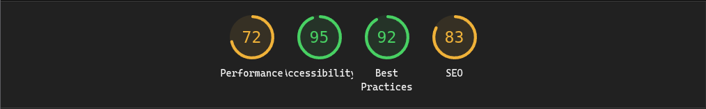
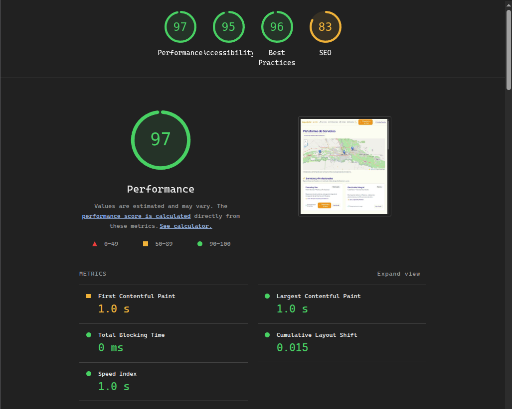
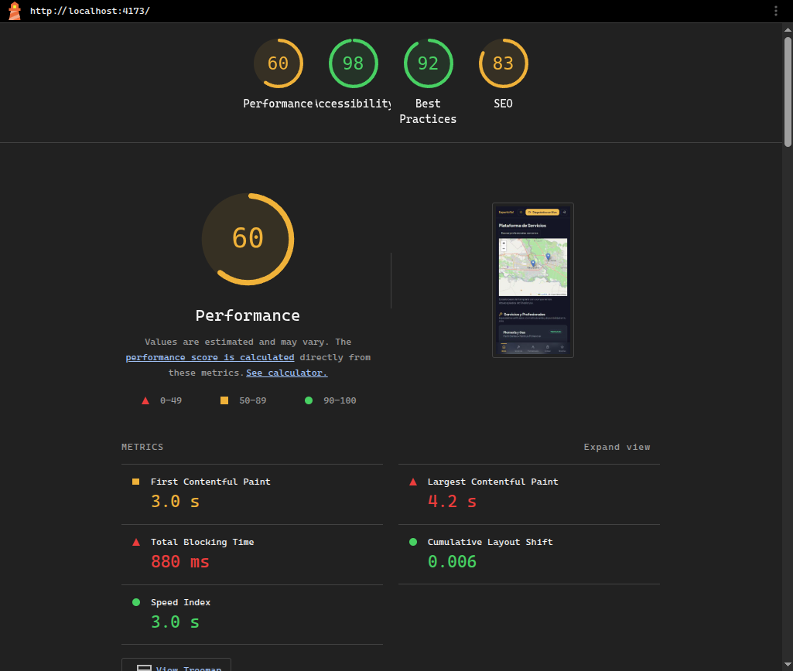
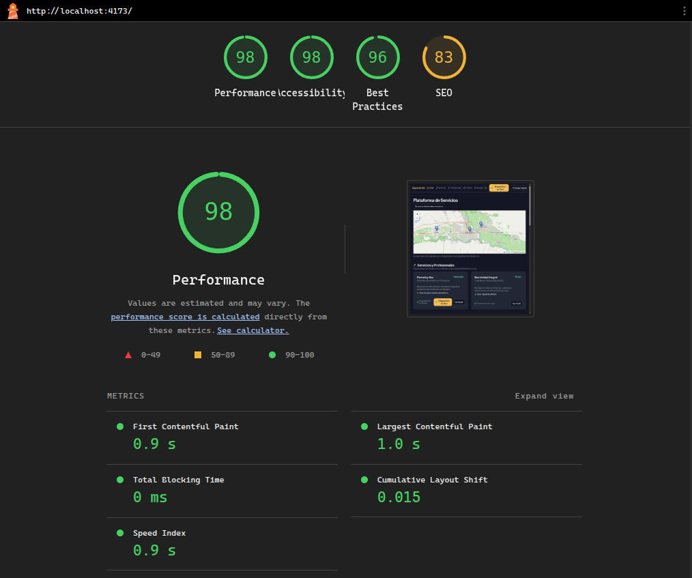

Los reportes completos están en los archivos `.html` de la misma carpeta.

## 4. Hallazgos de accesibilidad (Lighthouse)

Lighthouse coincide con WAVE en los problemas de contraste y agrega dos auditorías que WAVE no reporta como error.

### 4.1 Contraste

| Elemento | Colores | Ratio | Resultado |
|---|---|---|---|
| Logo "ExpertoYa!" | `#FF8C00` sobre `#FDFCF4` | 2.26:1 | Falla |
| Botón "Diagnóstico en Vivo" (header y tarjeta) | `#FFFFFF` sobre `#FF8C00` | 2.33:1 | Falla |
| Alerta éxito, título | `#10B981` sobre `#FDFCF4` | 2.46:1 | Falla |
| Alerta éxito, texto | `#28C08D` sobre `#FDFCF4` | 2.26:1 | Falla |
| Alerta advertencia, título | `#F59E0B` sobre `#FDFCF4` | 2.08:1 | Falla |
| Alerta advertencia, texto | `#F6A722` sobre `#FDFCF4` | 1.94:1 | Falla |
| Alerta error, título | `#EF4444` sobre `#FDFCF4` | 3.65:1 | Falla |
| Alerta error, texto | `#F05656` sobre `#FDFCF4` | 3.30:1 | Falla |
| Badge "MÓDULO CLOSED-LOOP" | `#FF8C00` sobre `#FDFCF4` | 2.26:1 | Falla |
| "5 de 5 estrellas" | `#FF8C00` sobre `#FFFFFF` | 2.33:1 | Falla |
| Error de reseñas | `#EF4444` sobre `#FDFCF4` | 3.65:1 | Falla |
| Menú inferior móvil (10 px) | `#FF8C00` sobre `#FFFFFF` | 2.33:1 | Falla |

En **modo oscuro los 13 errores desaparecen**: los tokens `#FFB74D`, `#34D399`, `#FBBF24` y `#F87171` sobre `#121826` sí cumplen. El problema de contraste es exclusivo del tema claro.

### 4.2 Otras auditorías fallidas

- **Heading-order:** `AlertTitle` renderiza `h5` debajo de un `h2`, salto de tres niveles.
- **Label-content-name-mismatch:** el botón "Diagnóstico en Vivo" tiene texto visible, pero su `aria-label` es "Iniciar videollamada de diagnóstico preliminar". El nombre accesible no coincide con el texto visible.
- **`<html lang="en">`:** el documento declara inglés aunque todo el contenido está en español. Los lectores de pantalla lo pronuncian mal. Lighthouse no lo marca como error, se detectó por inspección.

### 4.3 Best Practices

- **errors-in-console:** `ERR_CONNECTION_REFUSED` por el backend apagado (reseñas y envíos). Limitación del entorno.
- **valid-source-maps:** el build no genera source maps para el JS de primera parte.
- **image-size-responsive (mobile):** tiles de OpenStreetMap servidos con resolución menor a la necesaria.

### 4.4 SEO

- **meta-description:** falta `<meta name="description">`.
- **robots-txt:** inválido, 18 errores; el servidor de preview devuelve el HTML en `/robots.txt`.

### 4.5 Performance

- Render-blocking: ~900 ms en mobile y ~560 ms en desktop.
- JavaScript sin usar: 129 KiB.
- Main-thread work: 2.4 s en mobile.
- CSS sin usar: 10 KiB.
- Cache: 26–41 KiB de ahorro estimado.
- Principal sospechoso: el mapa (Leaflet + tiles externos) y la carga inicial de React.

## 5. Pruebas de diseño adaptable

### 5.1 Anchos

| Ancho | Navegación | Desborde horizontal | Observaciones |
|---|---|---|---|
| 320 px | Bottom nav visible | No visible | Header entra justo: logo, tema, "Diagnóstico en Vivo" en dos líneas y login solo ícono. La etiqueta "Profesional..." se trunca en la bottom nav. |
| 768 px | Nav superior; desaparece la bottom nav | No visible | Se activa el breakpoint `md`. Tarjetas en 2 columnas. |
| 1440 px | Nav superior | No visible | Contenido centrado a `max-w-5xl` (~1024 px). |

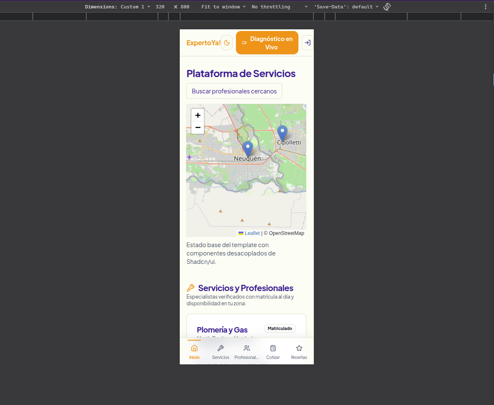
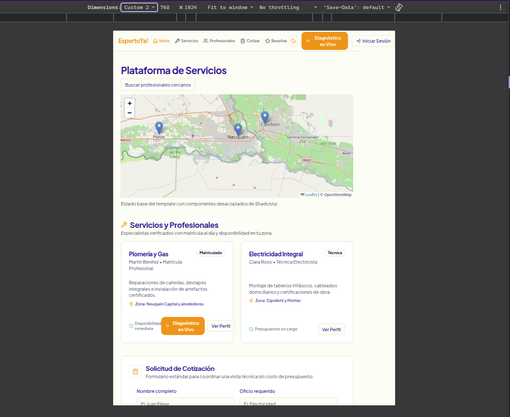
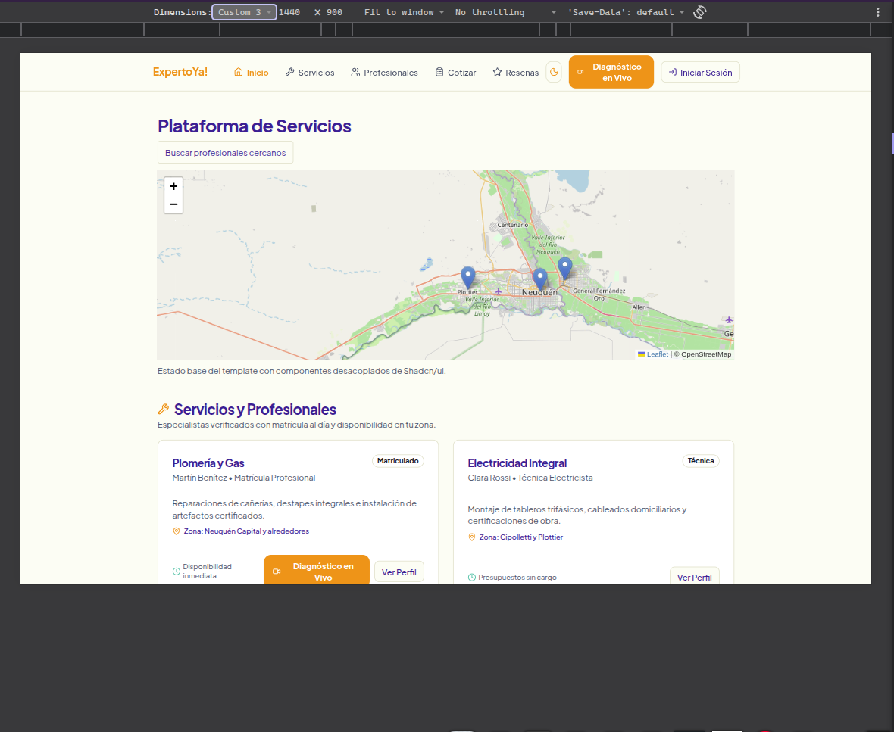

**Defecto de layout:** en 768 y 1440 el botón "Diagnóstico en Vivo" **se superpone** con "Disponibilidad inmediata" y queda encimado sobre "Ver Perfil" en la primera tarjeta.

### 5.2 Zoom 200 %

Con la ventana a 1920 px y zoom al 200 % (viewport CSS ≈ 960 px):

- Sin scroll horizontal.
- El header entra completo en una fila.
- El formulario mantiene alineación y dos columnas.
- El mapa conserva Neuquén y los tres marcadores.
- Limitación: no se probó 200 % sobre una pantalla física chica (por ejemplo 1366 px, que daría ~683 px CSS y activaría la navegación móvil).

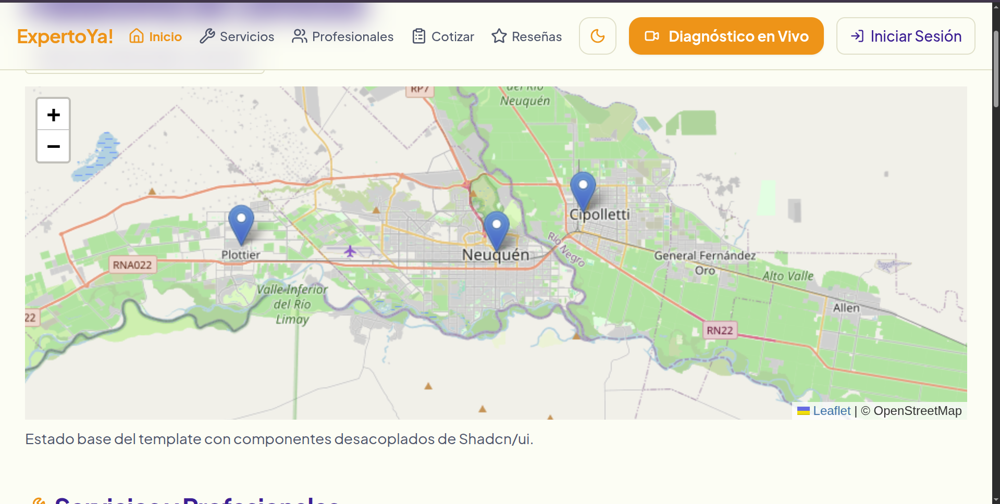
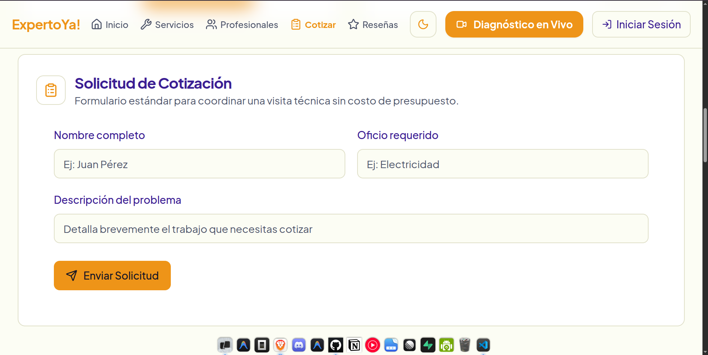

### 5.3 Orientación horizontal (667 × 375)

- **El mapa tapa la bottom nav.** Leaflet usa `z-index` internos de 400–700 y la nav usa `z-50`, así que en landscape el mapa queda por encima y la navegación desaparece.
- El mapa de 320 px ocupa casi todo el viewport de 375 px; el header y la nav fija consumen ~128 px (34 %).
- El mapa captura el gesto de arrastre, lo que dificulta scrollear la página en mobile.
- En el formulario la bottom nav queda sobre el final de la tarjeta; "Enviar Solicitud" se alcanza justo.
- La captura del formulario muestra un posible recorte horizontal a la izquierda; no se confirmó con `scrollWidth`, queda como limitación de la evidencia.

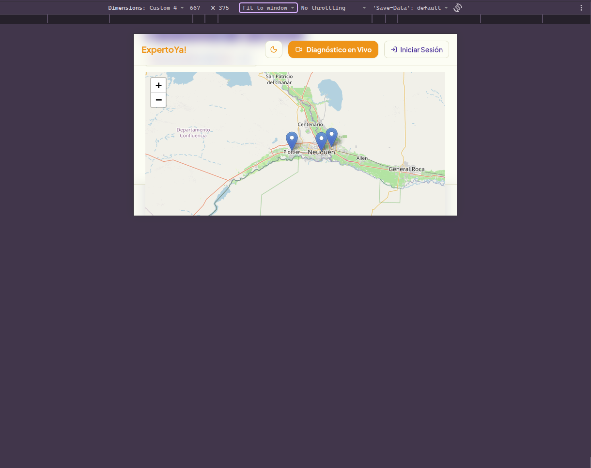
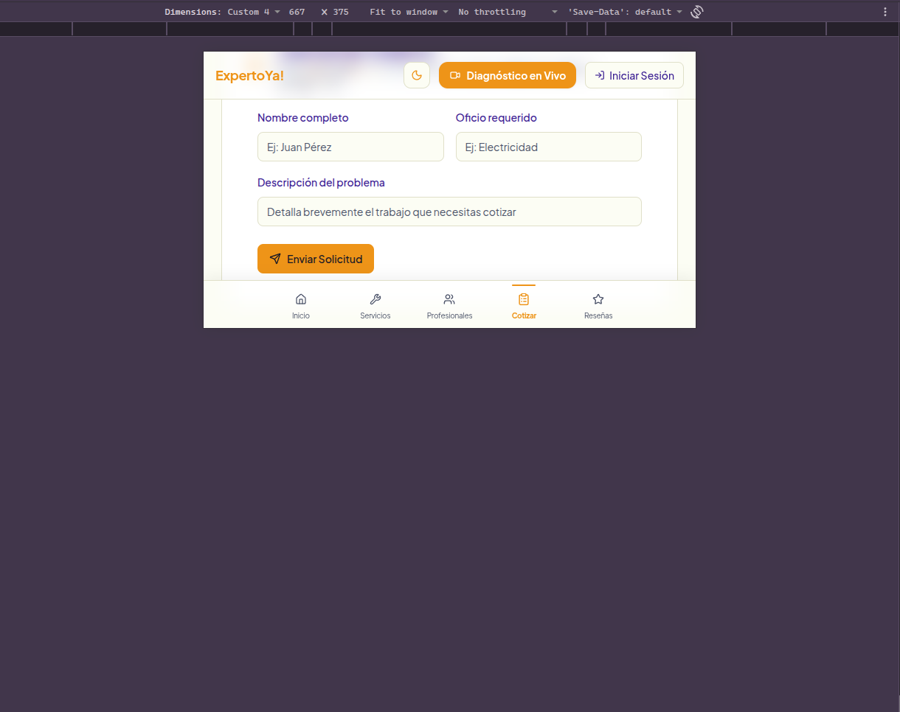

### 5.4 Navegación por teclado

| Elemento | Resultado |
|---|---|
| Logo "ExpertoYa!" | **Foco invisible**: `focus:outline-none` sin anillo alternativo. |
| Nav superior (5 ítems) | Foco visible con el outline del navegador. |
| Botón de tema, "Diagnóstico en Vivo", "Iniciar Sesión" | Foco visible con `focus-visible:ring`. |
| "Buscar profesionales cercanos", controles de zoom de Leaflet | Alcanzables con Tab. |
| Marcadores del mapa y popups | **No alcanzables**: no son focusables y los popups solo se abren con clic. |
| Formularios (cotización, reseñas, registro) | Orden lógico, campos alcanzables, foco visible. |
| Estrellas de reseña | 5 tab stops separados; alcanzables, pero sin navegación con flechas ni `aria-checked`. |
| Modal de videollamada | **Sin gestión de foco**: no mueve el foco al abrir, no lo atrapa, no cierra con Escape y no tiene `aria-labelledby`. |

- No existe enlace "Saltar al contenido".
- No hay trampas de foco en el contenido principal; sí hay foco escapado en el modal.

## 6. Limitaciones de adaptabilidad

1. **Mapa en mobile y landscape:** altura fija de 320 px, `z-index` que tapa la navegación y captura del gesto de scroll. Es el principal límite de adaptabilidad.
2. **Modo oscuro:** el mapa mantiene tiles claros y genera un salto de luminancia dentro de la interfaz oscura.
3. **Contraste en claro:** la paleta naranja/verde/ámbar no alcanza 4.5:1 para texto; en oscuro sí cumple.
4. **Header en 320 px:** entra al límite, con el botón de videollamada en dos líneas y el login reducido a ícono.
5. **Bottom nav:** etiquetas de 10 px y truncamiento de "Profesional...".
6. **Backend detenido:** la lista de reseñas no se pudo evaluar y los errores de consola afectan Best Practices.
7. **Performance mobile:** LCP de 4 s y TBT alto, influidos por el mapa y los recursos externos. Hay variabilidad entre corridas.
8. **Cobertura:** una corrida por configuración, sin pruebas en dispositivos reales ni con throttling personalizado.
9. **Dependencia de tiles externos:** sin conexión, el mapa queda vacío y no hay alternativa textual (se vincula con TP4-14).

## 7. Priorización de mejoras

| Prioridad | Mejora | Impacto |
|---|---|---|
| Alta | Corregir contraste en modo claro (naranja más oscuro para texto, tokens de alerta) | Elimina 13 fallas de Lighthouse y WAVE |
| Alta | Resolver `z-index` del mapa y altura adaptable (`clamp`) | Recupera la navegación en landscape |
| Alta | Foco visible en el logo | Teclado |
| Alta | `lang="es"` en `index.html` | Pronunciación correcta |
| Alta | Vista de lista y marcadores accesibles (TP4-14) | Teclado y lector de pantalla |
| Media | Corregir superposición del footer de tarjetas en ≥768 px | Layout |
| Media | Foco atrapado y Escape en el modal de videollamada | Teclado |
| Media | `AlertTitle` como `h3` y `role="status"` en alertas estáticas | Estructura |
| Media | Tiles oscuros o filtro para el mapa en modo oscuro | Adaptabilidad visual |
| Media | `meta description` y `robots.txt` | SEO |
| Baja | Source maps, JS sin usar y render-blocking | Performance |
| Baja | Etiquetas de bottom nav más legibles | Mobile |

## 8. Evidencia

| Archivo | Contenido |
|---|---|
| `01-home-mobile-claro.png` / `.html` | Lighthouse mobile claro |
| `02-home-desktop-claro.png` / `.html` | Lighthouse desktop claro |
| `03-home-mobile-oscuro.png` / `.html` | Lighthouse mobile oscuro |
| `04-home-desktop-oscuro.png` / `.html` | Lighthouse desktop oscuro |
| `05-responsive-320.png` | Ancho 320 px |
| `06-responsive-768.png` | Ancho 768 px |
| `07-responsive-1440.png` | Ancho 1440 px |
| `08-zoom-200-home.png` | Zoom 200 %, inicio |
| `08-zoom-200-form.png` | Zoom 200 %, formulario |
| `09-landscape-667-home.png` | Landscape, inicio y mapa |
| `09-landscape-667-form.png` | Landscape, formulario y bottom nav |

Las capturas de foco de teclado (`10-foco-*.png`) no se incluyeron: el recorrido se documentó en la tabla de la sección 5.4.

## 9. Conclusión

El diseño **es adaptable en lo esencial**: no hay desborde horizontal en 320, 768 ni 1440 px, el zoom al 200 % no rompe el contenido y el rendimiento desktop es alto. Los límites aparecen en mobile y landscape por el mapa (altura fija, `z-index`, captura del scroll), en el contraste del tema claro y en detalles de teclado (logo sin foco visible, modal sin gestión de foco).

La accesibilidad medida por Lighthouse (95–98) está inflada por los cero errores automáticos de estructura: los problemas que más afectan a usuarios reales (mapa sin alternativa, contrastes, encabezados) se ven en WAVE y en las pruebas manuales, no en el puntaje global. Esa diferencia es, en sí misma, una conclusión del TP: **un puntaje alto de Lighthouse no garantiza accesibilidad**.
