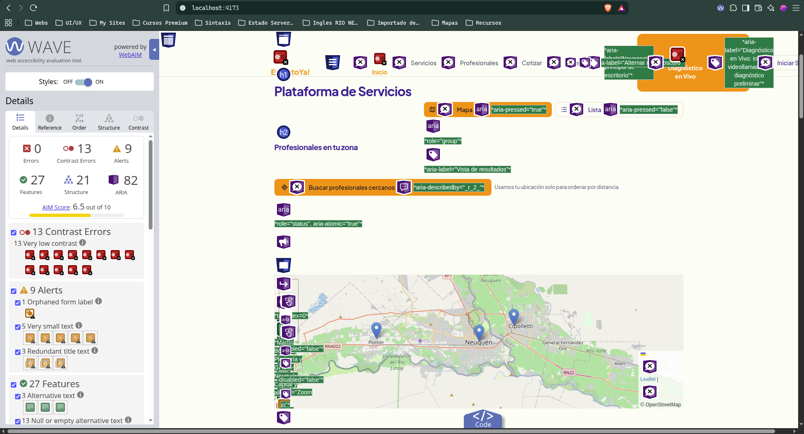
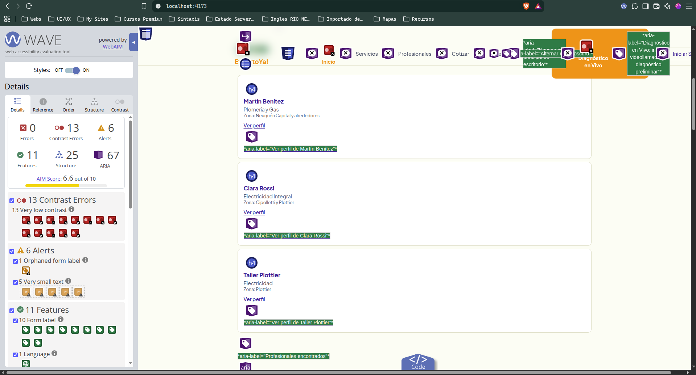
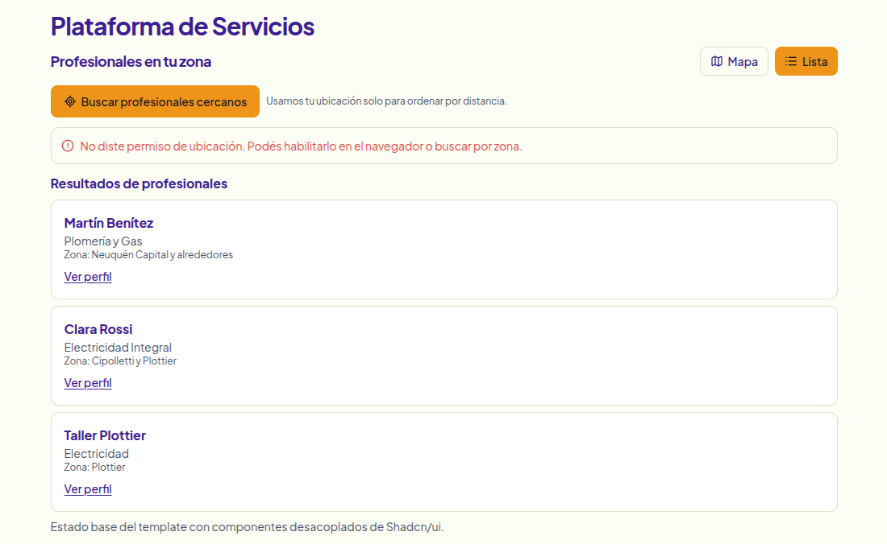

# TP4 · Actividad 3 · Implementación de ARIA en el mapa y vista de Lista accesible

## 1. Objetivo

Resolver los hallazgos críticos de la auditoría WAVE (TP4-12) relacionados con el mapa interactivo de profesionales y las alertas semánticas: dar una alternativa textual equivalente, anunciar los resultados, reemplazar el `alert()` nativo y ordenar la jerarquía de encabezados. Corresponde a la issue **TP4-14**.

## 2. Cambios implementados

### 2.1 Mapa y vista de Lista — `src/components/mapa-profesional.tsx`

- **Alternancia Mapa / Lista** dentro de un `role="group"` con `aria-label="Vista de resultados"`.
  - Cada botón expone `aria-pressed` (`true`/`false`) según la vista activa.
  - Al cambiar de vista el foco se mueve al destino: la región del mapa o el encabezado "Resultados de profesionales" (`tabIndex={-1}`), de modo que el lector anuncie el contexto nuevo sin perderse.
- **Sección del mapa** con `role="region"`, `aria-labelledby` (título "Profesionales en tu zona") y `aria-describedby` con una descripción `sr-only` que informa que los mismos resultados están en la vista de Lista.
- **Vista de Lista equivalente** en HTML semántico:
  - `<h3>Resultados de profesionales</h3>`.
  - `<ul aria-label="Profesionales encontrados">` con un `<li>` por profesional.
  - Cada ítem expone nombre (`h4`), oficio, zona, distancia calculada y acción "Ver perfil" con nombre accesible (`aria-label="Ver perfil de …"`).
  - Estado vacío con texto explicativo.
- **Anuncio de resultados** en una región `role="status"` con `aria-live="polite"` y `aria-atomic="true"` ("Se encontraron N profesionales cerca de tu ubicación").
- **Error de geolocalización inline** con `role="alert"`, ícono decorativo (`aria-hidden`) y mensajes específicos según el código de error (permiso denegado, ubicación no disponible, timeout). Se eliminó el `alert()` bloqueante.
- **Estado de carga** con `aria-busy` en el contenedor de resultados y texto "Buscando…" en el botón.
- **Marcadores accesibles**: `alt` y `title` con "Nombre, Oficio, Zona"; Leaflet les asigna `tabindex="0"` y `role="button"`, por lo que se alcanzan con Tab y se activan con Enter.
- **Popups con foco gestionado**: al abrirse, el foco entra al contenido del popup (legible por lector); `Escape` lo cierra y el foco vuelve al marcador que lo abrió. También se devuelve el foco al cerrar con el botón del popup.

### 2.2 Alertas semánticas — `src/components/ui/alert.tsx` y `src/App.tsx`

- `AlertTitle` pasa de `<h5>` a `<h3>`, eliminando el salto `h2 → h5` en las tres alertas del demo de Estados.
- Las tres alertas estáticas de `#estados` usan `role="status"` (polite). Los errores dinámicos de formularios conservan `role="alert"` (assertive).

### 2.3 Otros ajustes de accesibilidad detectados en la implementación

- `index.html`: `lang="en"` → `lang="es"`.
- `src/TP3/VideoCallRoom.jsx`: el `aria-label` del botón incluye el texto visible ("Diagnóstico en Vivo…"), corrigiendo `label-content-name-mismatch`.

## 3. Verificación

### 3.1 Automática

| Prueba | Resultado |
|---|---|
| `npm run build` | Compila sin errores. |
| `npx eslint` sobre los archivos modificados | Sin errores. |
| Lighthouse Accessibility (build de producción) | **96/100** (antes 95). Ya no reporta `heading-order` ni `label-content-name-mismatch`. |
| Lighthouse `color-contrast` | 13 elementos, los mismos de TP4-12; **ninguno nuevo** introducido por estos cambios. |

### 3.2 Prueba funcional con navegador (Brave headless + CDP)

- Mapa → Lista: los botones actualizan `aria-pressed`, la lista renderiza los 3 profesionales y el foco pasa al `h3`.
- Lista → Mapa: el foco pasa a la región del mapa.
- Geolocalización denegada: aparece el mensaje inline con `role="alert"`; no hay diálogo nativo.
- Geolocalización simulada con éxito: se anuncia "Se encontraron 2 profesionales…" y la lista muestra distancias.
- Marcadores: `role="button"`, `tabindex="0"` y `alt` con nombre, oficio y zona.
- Enter en un marcador abre el popup y mueve el foco a su contenido; `Escape` cierra y devuelve el foco al marcador.

## 4. Evidencia

## 5. Criterios de aceptación

| Criterio | Estado |
|---|---|
| Vista de Lista funcional y equivalente al mapa | Cumplido. |
| Atributos ARIA validados con WAVE sin errores nuevos | Cumplido: se mantienen los 13 avisos de contraste preexistentes. |
| Anuncios de resultados y errores funcionando | Cumplido (`role="status"` + `aria-live`, `role="alert"`). |
| Foco visible y orden lógico | Cumplido en alternancia de vista y popups. |
| PR contra `developer` con capturas y video corto | Capturas en este documento; video en la descripción del PR. |
| Sin regresiones visuales en mobile ni desktop | Verificado con el build de producción; el layout no cambia. |

## 6. Fuera de alcance

- Contraste de los 13 elementos en modo claro: se aborda en una issue posterior de diseño/tokens.
- Perfil de profesional real: "Ver perfil" enlaza a `#servicios` porque la pantalla de perfil no existe.
- Tiles oscuros para el mapa en modo oscuro.
