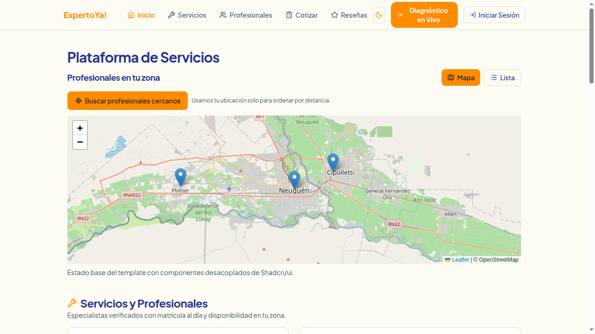
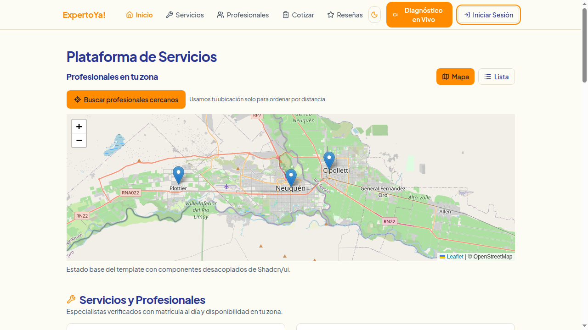
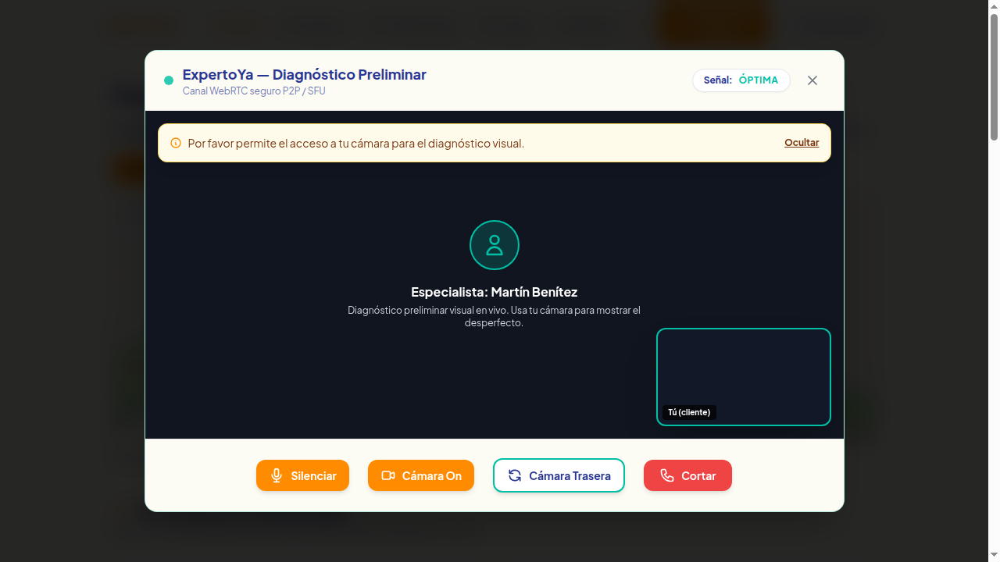
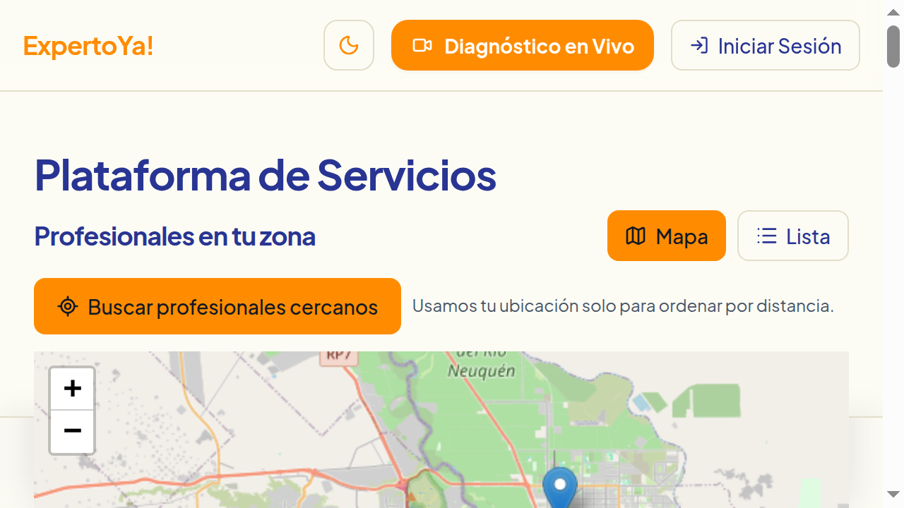
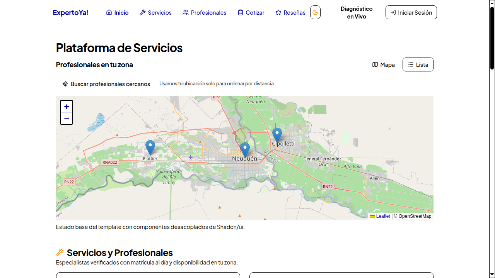
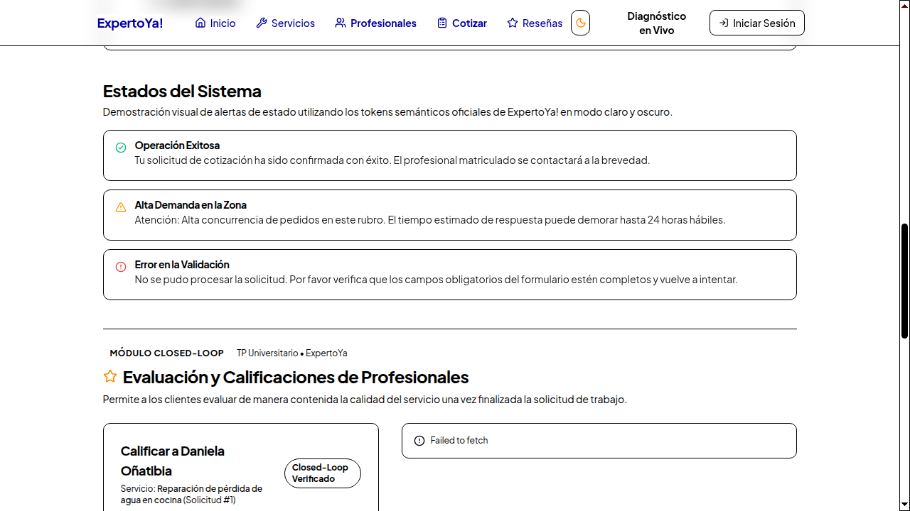
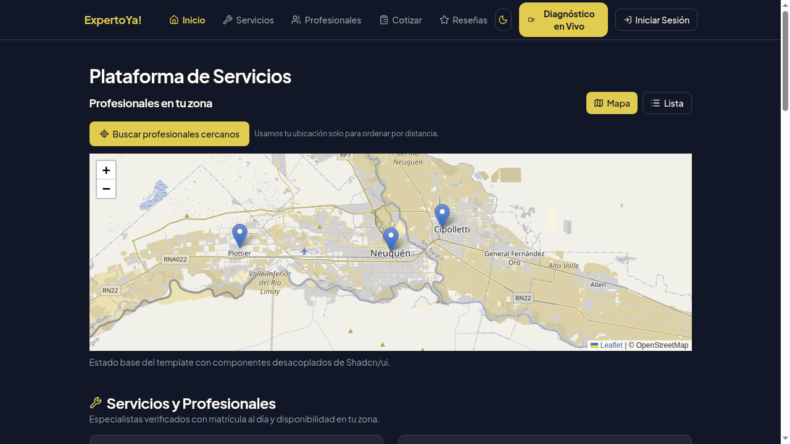
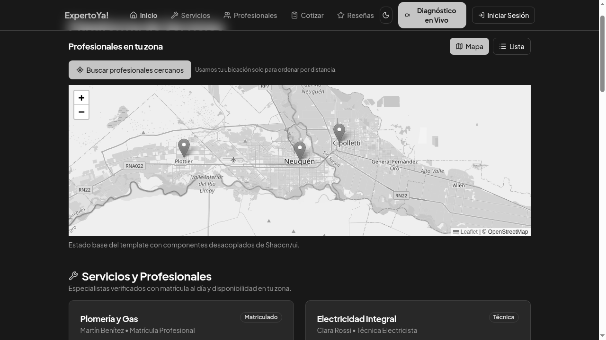
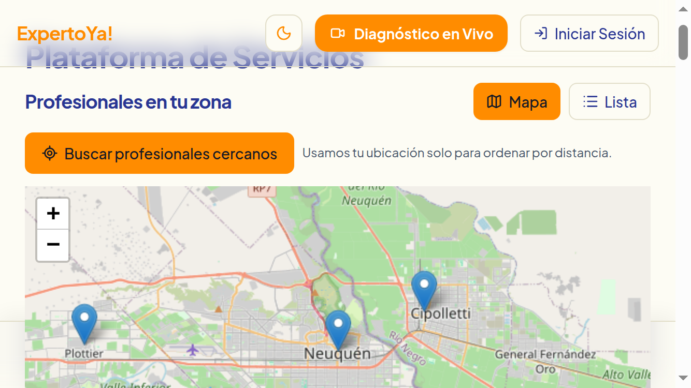

# TP4 · Actividad 3 · Pruebas con lector de pantalla, teclado y zoom

## 1. Objetivo y alcance

Validar ExpertoYa con tecnología asistiva real y condiciones de adaptabilidad, más allá de lo que detectan WAVE y Lighthouse. Se recorrió el flujo completo de búsqueda de profesionales y cotización, y se complementó con pruebas de teclado, zoom, alto contraste, modo oscuro y baja visión simulada.

Esta issue (**TP4-15**) es de prueba y documentación: no modifica código de la aplicación.

## 2. Entorno de prueba

| Elemento | Valor |
|---|---|
| Fecha | 19/11/2026 |
| Sistema | Linux Mint 22.1, sesión X11 |
| Navegador | Brave 158.1.100.58 |
| Lector de pantalla | Orca 46.1 (speech-dispatcher) |
| URL | `http://127.0.0.1:5173` (`npm run dev`) |
| Backend | Apagado a propósito (`ECONNREFUSED`), para probar los estados de error |
| Evidencia de voz | Log de depuración de Orca (`--debug-file`), extracto en [`img/asistivas/orca-extracto.txt`](img/asistivas/orca-extracto.txt) |

## 3. Metodología

1. **Lector de pantalla:** sesión guiada con Orca sobre el flujo completo: carga, navegación por landmarks y encabezados, mapa/lista, búsqueda con permiso denegado, cotización, reseñas y registro.
2. **Teclado:** recorrido con `Tab`/`Shift+Tab`/`Enter`/`Espacio`/`Escape` sobre toda la página, registrando orden, foco visible y trampas.
3. **Zoom:** emulación de viewport CSS de 640 px (200 %) y 320 px (400 %, equivalente a 1280×1024) con capturas y medición de `scrollWidth`.
4. **Alto contraste:** emulación de `forced-colors: active` y verificación de indicadores de foco.
5. **Baja visión:** modo oscuro con emulación de deuteranopia y acromatopsia.
6. **Adaptabilidad:** 375×667 (mobile), 667×375 (landscape) y 320×256 (reflow).

## 4. Resultados generales

### 4.1 Lo que funciona bien

| Área | Resultado |
|---|---|
| Estructura | Orca anuncia **4 landmarks**, **16 encabezados**, **3 formularios** y el título de la página correctamente. |
| Navegación | Orden de `Tab` lógico: logo → navegación → acciones del header → mapa → servicios → cotización → reseñas → registro → ficha de perfil. |
| Mapa | La región **"Profesionales en tu zona"** se anuncia con su descripción: *"Mapa interactivo de profesionales. Los mismos resultados están disponibles en la vista de lista"*. |
| Alternancia Mapa/Lista | Orca anuncia el grupo **"Vista de resultados"** y el estado: *"Mapa toggle button pulsado"*, *"Lista toggle button no pulsado"*. |
| Vista de Lista | Se anuncia **"Resultados de profesionales, heading nivel 3"**, **"Lista con 3 elementos"** y cada enlace **"Ver perfil de Martín Benítez"**. |
| Marcadores | Se anuncian como botones con nombre completo: *"Martín Benítez, Plomería y Gas, Neuquén Capital y alrededores, push button"*. |
| Foco al cambiar de vista | Pasa al encabezado de la lista o a la región del mapa, según corresponda. |
| Anuncio de búsqueda | Orca anuncia *"Buscando profesionales cerca de tu ubicación…"* y luego el error de permiso. |
| Error de geolocalización | Se anuncia solo, sin diálogo nativo: *"No diste permiso de ubicación. Podés habilitarlo en el navegador o buscar por zona"*. |
| Formularios | Las etiquetas se anuncian correctamente: "Nombre completo", "Oficio requerido", "Descripción del problema", "Rol en la plataforma". |
| Error de cotización | El mensaje *"No se pudo enviar. Completá todos los campos e intentá de nuevo"* se anuncia automáticamente. |
| Zoom 200 % | Sin scroll horizontal; el contenido se reacomoda en una columna. |
| Contraste en oscuro | Sin errores de contraste (AIM 9.8 de TP4-12). |

### 4.2 Hallazgos

| # | Severidad | Hallazgo | Impacto | Criterio |
|---|---|---|---|---|
| 1 | **Crítica** | El modal de videollamada no recibe el foco al abrirse, no atrapa el foco, no se cierra con `Escape` y no tiene nombre accesible. | Un usuario de teclado o lector queda en la página de fondo: `Tab` recorre el contenido oculto y no puede salir del modal. | 2.1.1, 2.1.2, 2.4.3, 2.4.7 |
| 2 | **Alta** | El logo "ExpertoYa!" no muestra foco: `outline` transparente y sin `box-shadow`. | Primer elemento de la página: el usuario no sabe dónde está el foco. | 2.4.7 |
| 3 | **Alta** | En alto contraste (`forced-colors`) desaparecen los anillos de foco de los botones: `outline: none` y `box-shadow: none`. | Usuarios de alto contraste pierden por completo la ubicación del foco. | 2.4.7, 2.4.11 |
| 4 | **Alta** | En landscape 667×375 el mapa (320 px de alto) tapa la barra de navegación inferior: mapa `bottom=500`, nav `top=310`. | La navegación principal móvil queda inutilizable en horizontal. | 2.4.11, 1.4.10 |
| 5 | **Media** | A 400 % de zoom (320 px CSS) hay 2 px de desborde horizontal y el header recorta "Iniciar Sesión". | Aparece scroll horizontal y un control queda parcialmente fuera de pantalla. | 1.4.10 |
| 6 | **Media** | Las estrellas de reseña no están en un grupo semántico: la pregunta no está asociada y no hay `aria-pressed`. | Orca lee cinco botones sueltos; no se anuncia qué se está calificando ni el estado seleccionado. | 1.3.1, 3.3.2, 4.1.2 |
| 7 | **Media** | Al cambiar el rol a "Cliente" desaparece "Oficio o Especialidad" sin `aria-live` ni mensaje. | El cambio de contexto se percibe solo por el salto de foco; puede desorientar. | 4.1.3 |
| 8 | **Media** | Cotización no usa `required`/`aria-required` ni validación por campo; "Descripción del problema" es un `input` de una línea. | El usuario descubre los faltantes recién cuando falla el envío; el error es genérico. | 3.3.1, 3.3.2 |
| 9 | **Media** | "Ver Perfil" es un botón sin acción. | Orca lo anuncia como botón, se activa y no ocurre nada. | 4.1.2, 3.2.2 |
| 10 | **Media** | Los tres mensajes estáticos de `#estados` se leen al cargar la página. | Aunque son `role="status"`, Orca anuncia los tres textos seguidos; agrega ruido inicial. | 4.1.3 |
| 11 | **Media** | El error de red de reseñas ("Failed to fetch") está en inglés y no se anuncia. | Si falla la red, el usuario de lector no se entera. | 4.1.3 |
| 12 | **Baja** | El mapa agrega 7 paradas de `Tab` (contenedor, 3 marcadores, zoom +, zoom −, atribución) y los controles se anuncian en inglés ("Zoom in", "Zoom out"). | Recorrido más largo y cambio de idioma en medio del flujo. | 3.1.2 |
| 13 | **Baja** | En modo oscuro los tiles del mapa siguen claros. | Cambio brusco de luminancia para baja visión. | 1.4.3 (contexto) |

## 5. Prueba con lector de pantalla (Orca)

### 5.1 Evidencia de voz

El log de Orca confirma los anuncios principales:

```text
17:07:01.119196 | La página tiene 4 marcas, 16 encabezados, 3 formularios, 7 enlaces no visitados.
17:07:33.508089 | Profesionales en tu zona región se puede pulsar.
17:07:33.513885 | Mapa interactivo de profesionales. Los mismos resultados están disponibles en la vista de lista.
17:07:35.480231 | Vista de resultados panel.
17:07:35.485394 | Mapa toggle button pulsado.
17:07:35.492845 | Lista toggle button no pulsado.
17:08:07.838997 | Martín Benítez, Plomería y Gas, Neuquén Capital y alrededores Clara Rossi, ... Taller Plottier, ...
17:08:08.199406 | Martín Benítez, Plomería y Gas, Neuquén Capital y alrededores push button.
17:10:35.998789 | Resultados de profesionales heading nivel 3 se puede pulsar.
17:10:44.030848 | Lista con 3 elementos.
17:10:44.034923 | Ver perfil de Martín Benítez link.
17:11:13.658923 | No diste permiso de ubicación. Podés habilitarlo en el navegador o buscar por zona.
17:13:11.162323 | No se pudo enviar. Completá todos los campos e intentá de nuevo.
```

El extracto completo está en [`img/asistivas/orca-extracto.txt`](img/asistivas/orca-extracto.txt).

### 5.2 Observaciones

- **Mapa/Lista:** la alternancia y el foco funcionan; el popup de un marcador se abre con `Enter`, el foco entra al contenido y `Escape` lo cierra devolviendo el foco al marcador (verificado en la sesión y con prueba de teclado).
- **Reseñas:** Orca anuncia *"Calificar con N estrellas, push button"*; el nombre del botón da una confirmación parcial, pero no existe un estado de selección (`aria-pressed`) ni una relación con la pregunta visible.
- **Registro:** el selector de rol se anuncia bien, pero no hay un mensaje dedicado cuando el campo de oficio aparece o desaparece.
- **Modal de videollamada:** al abrirlo, el foco permanece en el botón de fondo; `Tab` sigue recorriendo la página oculta y `Escape` no cierra. Es el hallazgo más grave de la prueba.

## 6. Prueba solo con teclado

Se recorrieron 42 paradas de `Tab` hasta volver al inicio del documento. El orden coincide con el orden visual. Resultados:

- Todos los controles son alcanzables y activables con `Enter`/`Espacio`, salvo el contenido del modal, que queda detrás del overlay.
- Los enlaces del menú, botones de tema, video, login, mapa/lista y búsqueda tienen anillo visible **excepto el logo**.
- Los campos de formulario reciben el foco y muestran el anillo del componente.
- Los marcadores del mapa muestran un `outline` negro de 1 px y se abren con `Enter`.
- **Trampa de foco:** no hay trampa en el flujo normal, pero sí un foco "perdido" en el modal: el foco nunca entra y no se puede cerrar con teclado.





## 7. Zoom y reflow

| Prueba | Resultado | Evidencia |
|---|---|---|
| 200 % (640 px CSS) | Sin scroll horizontal (`scrollWidth=625`). Header, mapa y formulario se reacomodan. | `02-zoom-200-home.png`, `03-zoom-200-cotizacion.png`, `04-zoom-200-mapa.png` |
| 400 % (320 px CSS) | `scrollWidth=322` → 2 px de desborde. El grupo "Diagnóstico en Vivo / Iniciar Sesión" llega a `right=322` y el login queda recortado. | `05-zoom-400-home.png`, `06-zoom-400-cotizacion.png`, `07-zoom-400-mapa.png` |




## 8. Alto contraste

Con `forced-colors: active`, el foco sobre el botón "Mapa" queda sin indicador:

```text
outline: none 3px rgb(0, 0, 0)
box-shadow: none
```

Los botones que dependen de `box-shadow` para el anillo (`focus-visible:ring-*`) y de `focus:outline-none` pierden todo indicador visual. Las alertas siguen siendo distinguibles por ícono y borde, pero el estado `aria-pressed` de Mapa/Lista se pierde visualmente porque ambos botones se ven iguales.




## 9. Modo oscuro y baja visión simulada

- **Deuteranopia:** la interfaz sigue siendo operable; el mapa claro contrasta fuertemente con el fondo oscuro.
- **Acromatopsia:** los estados y enlaces se distinguen por forma/posición, pero la selección de Mapa/Lista depende solo del relleno.
- **Tiles claros:** el mapa no adapta su paleta al modo oscuro, lo que provoca deslumbramiento en baja visión.




## 10. Adaptabilidad mobile y landscape

| Viewport | Resultado | Evidencia |
|---|---|---|
| 375×667 | Layout de una columna; barra inferior visible y usable; el mapa queda por encima del contenido esperado. | `15-mobile-375-home.png`, `16-mobile-375-mapa.png` |
| 667×375 | **El mapa tapa la barra inferior**: mapa `top=180, bottom=500`; nav `top=310, bottom=375`. | `17-landscape-667-mapa.png` |
| 320×256 (400 %) | Header desborda 2 px; la barra inferior ocupa 65 px y tapa el inicio del contenido. | `05-zoom-400-home.png` |



## 11. Limitaciones

- Se usó **Orca en Linux** como lector disponible, no NVDA ni VoiceOver. Los hallazgos de semántica y anuncios son transferibles, pero se recomienda una validación final con NVDA/VoiceOver antes de cerrar la sección del informe.
- El **backend estaba apagado**, por lo que no se probaron envíos exitosos ni reseñas reales; los errores observados son de red y no deben confundirse con validaciones de negocio.
- No se probó con lector de pantalla móvil (TalkBack/VoiceOver iOS); mobile se validó de forma visual y por reflow.
- El zoom se emuló cambiando el viewport CSS, no con el zoom del navegador sobre un monitor físico; los valores de reflow (640 y 320 px) son los que exige la norma.
- El popup del mapa se verificó con foco y teclado, pero su anuncio no quedó en el extracto del log de Orca.
- El contraste de los 13 elementos en modo claro ya está documentado en TP4-12 y Lighthouse (TP4-13); esta prueba se enfocó en tecnología asistiva y adaptabilidad.

## 12. Priorización para TP4-16

1. **Corregir el modal de videollamada**: mover el foco al abrir, atraparlo, cerrar con `Escape`, devolverlo al botón y darle `aria-labelledby`.
2. **Asegurar foco visible** en logo y en `forced-colors` (usar `outline` real, no solo `box-shadow`).
3. **Resolver el solapamiento del mapa con la barra inferior** en landscape y el desborde del header a 320 px.
4. **Agrupar las estrellas** con `fieldset/legend` o `radiogroup`, `aria-checked` y anuncio de la selección.
5. **Anunciar el cambio de rol** en registro con `aria-live` y mantener el foco en un lugar predecible.
6. **Validación de cotización** con `required`, `aria-invalid`, `aria-describedby` y foco en el primer error.
7. **Reemplazar "Ver Perfil"** por un enlace real o deshabilitarlo con explicación.
8. **Revisar los mensajes estáticos** de `#estados` para que no se lean los tres al cargar.
9. **Traducir los controles de Leaflet** y valorar un tema oscuro para los tiles.

## 13. Evidencia fotográfica

| Archivo | Qué muestra |
|---|---|
| `01-zoom-100-home.png` | Línea base a 100 %. |
| `02-zoom-200-home.png` | Inicio a 200 %. |
| `03-zoom-200-cotizacion.png` | Cotización a 200 %. |
| `04-zoom-200-mapa.png` | Mapa a 200 %. |
| `05-zoom-400-home.png` | Inicio a 400 %: desborde y header recortado. |
| `06-zoom-400-cotizacion.png` | Cotización a 400 %. |
| `07-zoom-400-mapa.png` | Mapa a 400 %. |
| `08-alto-contraste-estados.png` | Alertas en alto contraste. |
| `07-alto-contraste-mapa.png` | Mapa en alto contraste, sin foco visible. |
| `09-oscuro-deuteranopia-home.png` | Inicio oscuro con deuteranopia. |
| `10-oscuro-deuteranopia-mapa.png` | Mapa oscuro con deuteranopia. |
| `11-oscuro-acromatopsia-mapa.png` | Mapa oscuro con acromatopsia. |
| `12-oscuro-acromatopsia-home.png` | Inicio oscuro con acromatopsia. |
| `13-foco-logo.png` | Foco del logo: invisible. |
| `14-foco-boton.png` | Foco de botón: visible. |
| `15-mobile-375-home.png` | Inicio en 375×667. |
| `16-mobile-375-mapa.png` | Mapa en 375×667. |
| `17-landscape-667-mapa.png` | Landscape: mapa sobre la barra inferior. |
| `18-modal-videollamada.png` | Modal de videollamada abierto. |
| `orca-extracto.txt` | Extracto del log de voz de Orca. |

## 14. Conclusión

La vista de Lista y los atributos ARIA del mapa resolvieron el problema central de TP4-12: el flujo de búsqueda ahora es comprensible y operable con lector de pantalla y teclado. Las brechas restantes no están en el mapa, sino en componentes periféricos: el modal de videollamada (crítico), los indicadores de foco en logo/alto contraste, el reflow a 320 px, el solapamiento en landscape y la semántica de estrellas y formularios. Estos puntos se trasladan a TP4-16 como prioridades de corrección y a las limitaciones del informe.
