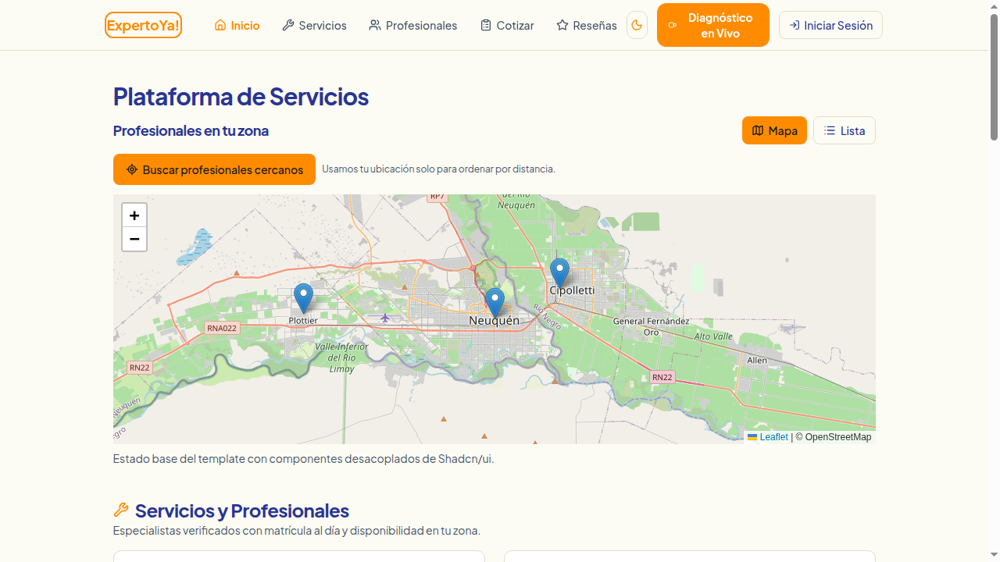
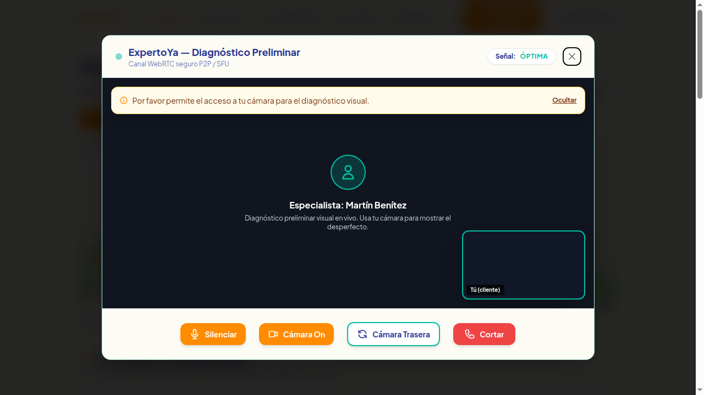
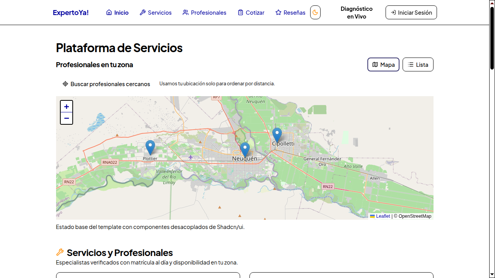
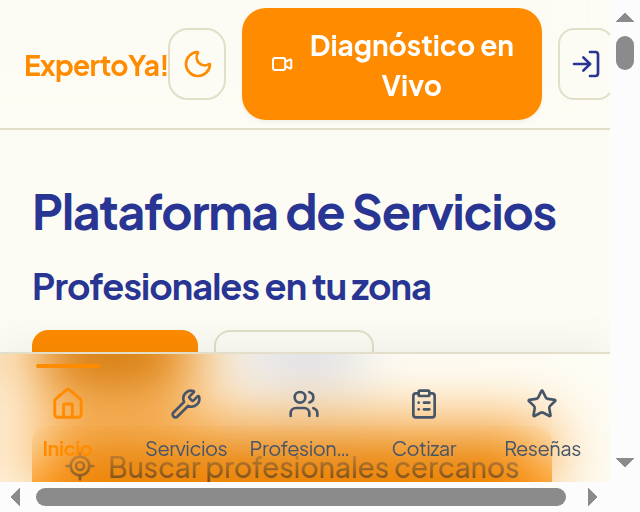
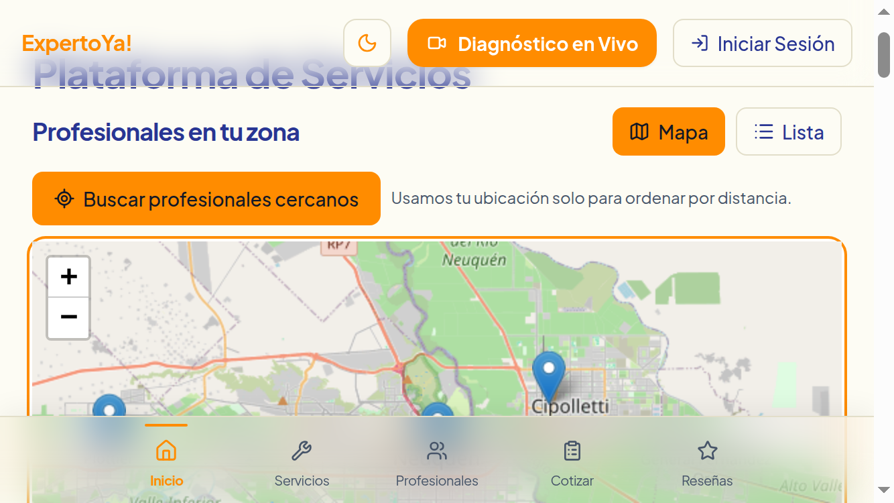

# TP4 · Actividad 3 · Correcciones críticas derivadas de TP4-15

## 1. Objetivo

Corregir los hallazgos de severidad crítica y alta detectados en las pruebas con Orca, teclado, zoom y alto contraste (TP4-15), antes de redactar la sección de accesibilidad del informe (TP4-16).

## 2. Correcciones aplicadas

| Hallazgo TP4-15 | Corrección | Archivos |
|---|---|---|
| El modal de videollamada no recibía foco, no lo atrapaba, no cerraba con `Escape` y no tenía nombre accesible. | Se guarda el botón que abrió el modal; al abrir, el foco entra al primer control; se atrapa `Tab`/`Shift+Tab`; `Escape` cierra y devuelve el foco; se agrega `aria-labelledby` apuntando al `h2` "ExpertoYa — Diagnóstico Preliminar". | `src/App.tsx`, `src/TP3/VideoCallRoom.jsx`, `src/TP3/VideoCallRoom.d.ts` |
| El logo "ExpertoYa!" no mostraba foco (`focus:outline-none`). | Se reemplaza por `focus-visible:outline-2 focus-visible:outline-offset-2 focus-visible:outline-ring` y `rounded-md`. | `src/App.tsx` |
| En `forced-colors` desaparecían los anillos de foco por depender de `box-shadow`. | Regla global `@media (forced-colors: active)` que fuerza `outline: 3px solid Highlight` y desactiva `box-shadow`; además, `[aria-pressed="true"]` recibe un contorno para que el estado activo no dependa solo del color. | `src/index.css` |
| A 400 % de zoom (320 px CSS) había 2 px de desborde y el login quedaba recortado. | Header con `px-3 sm:px-4` y logo `text-sm sm:text-base lg:text-lg`, lo que reduce el ancho del grupo de acciones. | `src/App.tsx` |
| En landscape 667×375 el mapa tapaba la barra inferior. | La barra inferior pasa de `z-50` a `z-[1000]`, por encima de los valores de Leaflet (400–700). | `src/App.tsx` |

## 3. Verificación

### 3.1 Compilación y lint

- `npm run build`: **OK**.
- `npx eslint src/App.tsx`: **sin errores**.

### 3.2 Pruebas funcionales (Brave headless + CDP)

| Prueba | Antes | Después |
|---|---|---|
| Foco del logo con `Tab` | `outline: rgba(0,0,0,0) solid 2px`, sin `box-shadow` | `outline: rgb(255,140,0) auto 2px`, visible |
| Abrir videollamada | Foco seguía en el botón de fondo | Foco en "Cerrar ventana de videollamada", dentro del modal |
| Nombre del modal | `aria-label: null`, `aria-labelledby: null` | "ExpertoYa — Diagnóstico Preliminar" |
| 14 tabulaciones con el modal abierto | Todas fuera del modal (`false`) | 14/14 dentro del modal (`true`) |
| `Escape` | Modal seguía abierto | Modal cerrado y foco devuelto a "Diagnóstico en Vivo" |
| `forced-colors: active` sobre "Mapa" | `outline: none`, `box-shadow: none` | `outline: rgba(5,0,73,0.8) solid 2px`, `box-shadow: none` |
| Reflow a 320 px | `scrollWidth=322` | `scrollWidth=310`, sin scroll horizontal |
| Landscape 667×375 | El mapa tapaba la barra inferior | `z-index=1000`; `elementFromPoint` sobre el centro de la barra devuelve un elemento de la barra |

## 4. Evidencia

## 5. Alcance

Estas correcciones no cubren los hallazgos de severidad media de TP4-15 (semántica de las estrellas, anuncio del cambio de rol, validación de cotización, mensajes estáticos y "Ver Perfil"). Éstos se documentan como propuestas priorizadas para TP4-16.
